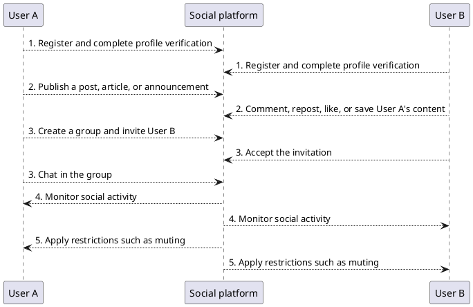
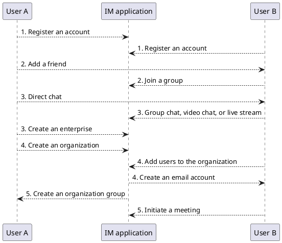

This booklet brings together my reading notes, architectural reflections, domain models, and code experiments from learning Domain-Driven Design (DDD). Its five parts follow a practical progression: theory, architecture, engineering reflections, modeling, and implementation. Some chapters are also available as individual posts; this collection keeps them together for continuous reading and reference.

> Reading notes: These are learning notes from the original writing period. COLA versions, project status, and NBA rule descriptions are historical context, not current official guidance. Chapters that were only headings in the source are explicitly marked rather than expanded. The prose is translated into English; diagrams retain their original Chinese labels. Translated book excerpts are rendered from the Chinese notes, not reproduced from an official English edition.
>
> Terminology: Domain events, event-driven architecture, and Event Sourcing are different concepts. Persisting messages does not by itself constitute Event Sourcing, which uses an event sequence as the source of truth for state. Some early notes below use these terms interchangeably; keep this distinction in mind.


## Part 1: DDD Theory

### Pattern Navigation Maps from Domain-Driven Design

When reading *Domain-Driven Design*, the original book uses a set of relationship diagrams to connect various patterns through their dependencies and combinations into a network. These diagrams provide a more intuitive explanation of why a certain pattern exists, which problems it addresses, and which other patterns it relies on.

Here are eight navigation maps organized according to the original book's structure, preserving the page numbers within the diagrams for easy reference against the original text.

#### General Overview Diagrams

Two general overview diagrams cover the full scope of all patterns in the book. The first one shows the relationships between building blocks, while the second one illustrates the relationships between strategic design and refinement.


#### I. Navigation Map for MODEL-DRIVEN DESIGN Language

This map shows how Model-Driven Design expresses models through entities, value objects, services, aggregates, factories, and repositories, as well as how layered architecture isolates the domain.


#### II. Navigation Map for Patterns of Model Integrity

A set of patterns that maintain model integrity, including Bounded Context, Continuous Integration, Context Maps, Shared Kernel, Client-Supplier, Conformist, Anticorruption Layer, Open Host Service, and Separate Ways.


#### III. Navigation Maps for Some Patterns That Aid Flexible Design

Patterns related to flexible design, including side-effect-free functions, assertions, Intention-Revealing Interfaces, Closure of Operation, Conceptual Contours, and Standalone Classes.


#### IV. Navigation Maps for Some Large-Scale Structure Patterns

Large-scale structure patterns, including System Metaphor, responsibility layers, knowledge hierarchies, pluggable frameworks, and Evolving Order.


#### V. Navigation Map for Strategic Refinement

Strategic refinement patterns, including core domain, subdomain, domain vision statement, separation of core, abstraction of core, highlighting the core, cohesion mechanisms, and declarative design.


#### VI. Navigation Map for Large-Scale Structure Combined with BOUNDED CONTEXT

When large-scale structures are combined with Bounded Contexts, how context maps, Ubiquitous Language, core domain, and Evolving Order are organized.


### Patterns in DDD

#### Background
When I first learned about Domain-Driven Design (DDD), I read "Domain-Driven Design: Tackling Complexity in the Heart of Software." This book records many concepts, methods, ideas, strategies, and patterns. Reading through it was quite challenging but also rewarding. Converting these into my own capabilities requires deep contemplation. Many people find DDD to have a high barrier to entry or that its related concepts and implementations are scattered, making them confusing. Online resources are often incomplete and not well-structured, usually being the result of secondary interpretations by others who only partially understand the subject matter. Therefore, for many engineers, DDD can seem like trying to see through a fog. Here, I will briefly summarize common concepts, methods, ideas, strategies, and some patterns from this book.

#### Pattern Overview
##### 2.1 Patterns Related to the Domain Model
###### 1. Ubiquitous Language (UL)
**Excerpt**: The vocabulary of UL includes the names of classes and major operations. Terms in the language are used to discuss rules that have been explicitly defined within the model, as well as some terms derived from high-level organizing principles applied to the model.

###### 2. Model-Driven Design (MDD)
**Excerpt**: MDD no longer separates analysis models from programming designs but seeks a single model that can satisfy both needs.

###### 3. Hands-On Modeler
**Excerpt**: Any technical personnel involved in modeling, regardless of their primary responsibilities within the project, must spend time understanding the code. Anyone responsible for modifying the code must learn to express the model using code. Every developer must participate in model discussions and maintain contact with domain experts to varying degrees.

##### 2.2 Model-Driven Design Patterns
###### 4. Layered Architecture (LA)
**Excerpt**: Divide complex applications into layers, designing each layer with cohesion and depending only on its lower layer. Use standard architectural patterns that loosely couple with upper layers. Place all code related to the domain model in one layer, separating it from user interface, application, and infrastructure layers.

###### 5. Smart UI
**Excerpt**: Many software projects adopt a simpler design method where the user interface, application, and domain are combined together, which I call SUI (Smart User Interface).

###### 6. Entity
**Excerpt**: When an object is distinguished by its identifier rather than attributes, it should be primarily defined through the identifier in the model. Make class definitions simple and focus on the continuity of the lifecycle and the identifier. Define a way to distinguish each object that is independent of form and history.

###### 7. Value Object
**Excerpt**: A value object describes an aspect of the domain without conceptual identity. VALUE OBJECTs are instantiated to represent design elements for which we only care what they are, not who they are.

###### 8. Service
**Excerpt**: Sometimes, objects are not things. In some cases, the clearest and most practical design includes special operations that conceptually do not belong to any object. Rather than force them into a category, it is better to introduce a new element in the model naturally, which is called SERVICE.

###### 9. Module/Package
**Excerpt**: MODULEs provide two ways of observing models: one can view details within a MODULE without being overwhelmed by the entire model, and another can observe relationships between MODULEs without considering their internal details. MODULEs in the domain layer should be meaningful parts of the model, providing a broader description of the domain.

###### 10. Aggregate
**Excerpt**: An AGGREGATE is a collection of related objects treated as a unit for data modification. Each AGGREGATE has a root and a boundary. The boundary defines what is inside the AGGREGATE. The root is a specific ENTITY within the AGGREGATE. External objects can only reference the root, while objects within the boundary can refer to each other. Other ENTITIES have local identifiers but are distinguished only within the AGGREGATE because external objects see only the root ENTITY.

###### 11. Factory
**Excerpt**: When creating an object or an entire AGGREGATE is complex and exposes too much internal structure, a FACTORY can be used to encapsulate this work.

###### 12. Repository
**Excerpt**: A REPOSITORY represents all objects of a certain type as a conceptual collection (usually simulated). Its behavior resembles that of a collection but with more advanced querying capabilities. When adding or removing corresponding objects, the backend mechanism of the REPOSITORY is responsible for adding them to the database or deleting them from it. This definition gathers a set of closely related responsibilities providing full access to the lifecycle of AGGREGATE roots.

##### 2.3 Deep Refactoring Patterns
###### 13. Specification
**Excerpt**: Create explicit VALUE OBJECTs in predicate form for special purposes. A SPECIFICATION is a predicate used to determine whether an object meets certain criteria.

###### 14. Strategy
**Excerpt**: We need to extract the mutable parts of a process into a separate "strategy" object within the model. Separate rules from the behavior they control. Implement rules or replaceable processes according to the STRATEGY design pattern, with multiple versions of strategy objects representing different ways to accomplish the process.

###### 15. Composite
**Excerpt**: Define an abstract type that includes all members of a COMPOSITE. On containers, implement query methods that return information aggregated by the container's content. Leaf nodes achieve these methods based on their own values. Clients use the abstract type without distinguishing between leaves and containers.

###### 16. Side-Effect-Free Function
**Excerpt**: Isolate commands—operations that visibly change state—into simple methods that do not return domain information. Put complex calculations into side-effect-free functions where possible, and move suitable logic into VALUE OBJECTs to further control side effects.

###### 17. Assertion
**Excerpt**: Clearly express the postconditions of an operation and fixed rules within classes and AGGREGATES. If your programming language does not support ASSERTION directly, write them as automated unit tests. You can also write them in documentation or diagrams (if fitting the project development style). Identify conceptually cohesive models to facilitate developers' inference of expected ASSERTIONS, accelerating learning and avoiding code contradictions.

###### 18. Conceptual Contour
**Excerpt**: Decompose design elements (operations, interfaces, classes, AGGREGATES) into cohesive units while considering the intuitive understanding of significant divisions in the domain. Observe regularities in changes and stability during continuous refactoring to find underlying CONCEPTUAL CONTOUR that can explain these change patterns. Align the model with consistent aspects of the domain that make it a useful body of knowledge.

###### 19. Standalone Class
**Excerpt**: Extract the most complex calculations into STANDALONE CLASSES (independent classes) where possible, one method to achieve this is by modeling VALUE OBJECTs from classes with many dependencies.

###### 20. Closure of Operations
**Excerpt**: Define operations such that their return type matches their parameter types when appropriate. If an implementer's state is used in the computation, it becomes a parameter and thus both parameters and returns should have the same type as the implementer. Such operations are closure operations within the set of instance collections of this type. Closure operations provide a high-level interface without introducing dependencies on other concepts.

###### 21. Intention-Revealing Interface
**Excerpt**: All public elements in the design form an interface, with each element's name revealing the design intention. Type names, method names, and parameter names combined together form an INTENTION-REVEALING INTERFACE (intention-revealing interface).

###### 22. Analysis Pattern
**Excerpt**: In "Analysis Patterns," Martin Fowler defines analysis patterns as a set of concepts used to represent common structures in business modeling [Fowler 1997, p. 8]. They may be specific to one domain or span multiple domains. The analysis patterns proposed by Fowler come from practical experience and are very useful when applied appropriately. "Analysis Pattern" emphasizes its conceptual nature; it is not a technical solution but rather references that guide the design of models in specific domains.

##### 2.4 Strategic Design Patterns
###### 23. Evolving Order
**Excerpt**: Let this conceptually large structure evolve with the application, even transforming into an entirely different architectural style.

Do not overly restrict detailed designs and model decisions; these must be determined after gaining a thorough understanding of the details.

###### 24. System Metaphor
**Excerpt**: SYSTEM METAPHOR is a loose, easily understood large structure that aligns with object paradigms. When a specific class in the system exactly matches team members' imagination and guides them towards useful thinking, use this metaphor as a large structure. Organize design around this metaphor and absorb it into UBIQUITOUS LANGUAGE. SYSTEM METAPHOR should facilitate communication within the system while guiding its development. It can increase consistency across different BOUNDED CONTEXTs but all metaphors are not precise; they should be continuously checked for overuse or inappropriateness, and abandoned when they start to hinder progress.

###### 25. Responsibility Layer
**Excerpt**: Observe concept dependencies within the model and varying frequencies and reasons of change in different parts of the domain. If natural layers emerge from the domain, convert them into broad abstract responsibilities. These responsibilities should describe the high-level purposes and designs of the system. Refactor the model so that each domain object, AGGREGATE, and MODULE's responsibility is clearly located within a responsibility layer.

###### 26. Knowledge Level
**Excerpt**: Create a separate set of objects to describe and constrain the structure and behavior of the basic model. Organize them into two levels: a concrete operational level, and a knowledge level containing rules that users or administrators can customize.

###### 27. Pluggable Component Framework
**Excerpt**: Mature models derived from deep understanding and repeated refinement offer many opportunities. Typically, only after multiple applications in the same domain can a PLUGGABLE COMPONENT FRAMEWORK (pluggable component framework) be used.

###### 28. Abstract Core
**Excerpt**: Identify the most fundamental concepts in the model and separate them into different classes, abstract classes, or interfaces. Design this abstract model to express much of the interaction between important components. Place this complete abstract model in its own MODULE while detailed specialized implementations remain within subdomain-defined MODULEs.

###### 29. Segregated Core
**Excerpt**: Refactor the model to separate core concepts from supporting elements (including those with unclear definitions) and enhance CORE's cohesion by reducing coupling with other code. Extract all general or supporting elements into other objects and place them in other packages, even if this separates some tightly coupled elements.

###### 30. Cohesive Mechanism
**Excerpt**: Separate the conceptually COHESIVE MECHANISM (cohesive mechanism) to a lightweight framework. Pay special attention to formulas or algorithms with complete documentation. Expose the functionality of this framework using an INTENTION-REVEALING INTERFACE. Now, other elements in the domain can focus on expressing problems (what to do) while transferring complex details of how it is done to the framework.

###### 31. Published Language
**Excerpt**: Use a well-documented shared language that expresses necessary domain information as a common communication medium, converting between this and other information when necessary.

###### 32. Bounded Context
**Excerpt**: Clearly define the context in which the model is applied. Set up the boundaries of the model based on team organization, usage within different parts of the software system, and physical manifestations (code and database schema). Maintain consistency within these boundaries without being disturbed by issues outside them.

###### 33. Core Domain
**Excerpt**: Refine the model to find the CORE DOMAIN and provide a clear method to distinguish it from auxiliary models and code. The most valuable and professional concepts should be clearly defined. Minimize the CORE DOMAIN. Have the most talented people develop the CORE DOMAIN, requiring corresponding recruitment. Develop deep models and flexible designs within the CORE DOMAIN that ensure system blueprints are realized. Carefully evaluate any other parts of the investment to see if they support this refined CORE.

###### 34. Highlighted Core
**Excerpt**: Write a very short document (3-7 pages, with each page not too much content) describing the CORE DOMAIN and interactions between core elements. Mark out the main storage repositories in the model that belong to the CORE DOMAIN without explicitly defining their roles. Make it easy for developers to distinguish what is inside the core and what is outside.

###### 35. Generic Subdomain
**Excerpt**: Identify cohesive subdomains unrelated to project intent. Extract generic models of these subdomains into separate MODULEs. Any proprietary elements should not be included in these modules. Separate them after which their priority should be lower than that of the CORE DOMAIN, and core developers should not be assigned to complete these tasks (as they rarely gain domain knowledge from such tasks). Additionally, consider using off-the-shelf solutions or "published models" for these GENERIC SUBDOMAINs.

###### 36. Continuous Integration
**Excerpt**: CONTINUOUS INTEGRATION involves frequently merging all work within a context and keeping it consistent to quickly discover and fix issues when the model splits. Like other methods in domain-driven design, CONTINUOUS INTEGRATION has two levels of operations: (1) integration of model concepts; (2) integration of implementations.

###### 37. Context Map
**Excerpt**: CONTEXT MAP lies at the intersection of project management and software design. Typically, boundaries are delineated based on team outlines. People who collaborate closely naturally share a model context. Different teams or individuals within the same team (who do not communicate) will use different contexts.

###### 38. Shared Kernel
**Excerpt**: Select a subset that both teams agree to share from the domain model. Of course, this also includes code and database design subsets related to this model part. This shared content has special status; one team should not change it without consulting the other team. Functional systems integrate frequently but at lower frequency than in BOUNDED CONTEXTs. During these integrations, both teams run tests.

###### 39. Customer/Supplier Development Team
**Excerpt**: Establish a clear customer/supplier relationship between two teams. In planning meetings, the downstream team acts as the customer to the upstream team. Negotiate tasks and budget based on the needs of the downstream team so everyone knows their commitments and progress. Develop automated acceptance tests together to verify expected interfaces. Add these tests to the upstream team's test suite as part of continuous integration. These tests allow the upstream team to make changes without worrying about side effects on the downstream team.

###### 40. Conformist
**Excerpt**: By strictly adhering to the model of the upstream team, you can eliminate the complexity of converting between BOUNDED CONTEXTs. Although this restricts the design style of the downstream developers and may not result in an ideal application model, choosing CONFORMITY mode greatly simplifies integration. Additionally, it allows for sharing UBIQUITOUS LANGUAGE with the supplier team, making communication easier as they share information out of benevolence.

###### 41. Anti-Corruption Layer
**Excerpt**: Create a layer to provide relevant functionality based on the customer's own domain model. This layer communicates with another system through its existing interface while requiring minimal changes or none at all. Internally, this layer performs necessary bidirectional conversions between models. It is the mechanism for converting conceptual objects and operations across different models and protocols.

###### 42. Separate Ways
**Excerpt**: Integration can be costly and may not always yield significant benefits. Therefore, declare a BOUNDED CONTEXT with no relation to other contexts so that developers can find simple, specialized solutions in this small scope.

###### 43. Open Host Service
**Excerpt**: Define an agreement where your subsystem is exposed as a set of SERVICES for other systems to access. Publish this protocol so all systems needing integration can use it. When new integration requirements arise, enhance and extend the protocol but accommodate individual team-specific needs with one-time converters that expand the protocol while keeping shared protocols simple and cohesive.

###### 44. Domain Vision Statement
**Excerpt**: Write a brief description (about one page) of the CORE DOMAIN along with its value proposition. Do not include aspects that cannot distinguish your domain model from others. Show how the domain model realizes and balances stakeholder interests. This description should be concise. Write it early and update it as new understanding emerges. The DOMAIN VISION STATEMENT can serve as a guide, helping development teams maintain a unified direction in refining models and code. Non-technical members of the team, management, or even customers (excluding proprietary information) can share this domain vision statement.

###### 45. Event Sourcing
**Excerpt**: Model activities within the domain as a series of discrete events, with each object represented by a domain object. Domain events are part of the domain model and represent things that happen in the domain.

###### 46. Big Ball of Mud
**Excerpt**: A Big Ball of Mud refers to messy, tangled, disorganized, and haphazardly patched-together code.

#### Summary
The patterns mentioned above are mostly copied directly from the book. Each pattern is briefly described to convey its general meaning. Many of these patterns do not have precise definitions, and I am still in the process of understanding them. This is similar to design patterns, which I refer to as DDD patterns for consistency with classic books and to align with design patterns. However, most people are familiar with and apply design patterns, making it easier to learn compared to DDD. It's recommended that those interested in learning DDD start by studying some design patterns.

Both types of patterns essentially express how object-oriented design can be implemented. According to Eric Evans' view, design patterns are more technical, while the patterns in DDD are theoretical or model-centric. These patterns aim to structure domain objects and models, guiding their construction and management, making them harder to understand.

I hope this article helps you gain some understanding of common concepts, methods, strategies, and patterns in DDD. However, for a deeper dive, I still recommend reading the classic books on DDD.

#### References
- "Domain-Driven Design: Tackling Complexity in the Heart of Software"
- "Implementing Domain-Driven Design"

[https://www.infoq.cn/article/2010/09/big-ball-of-mud](https://www.infoq.cn/article/2010/09/big-ball-of-mud)

[http://www.laputan.org/mud/](http://www.laputan.org/mud/)

### Ubiquitous Language in DDD

#### Ubiquitous Language: A Review

##### 1.1 Ubiquitous Language
Ubiquitous Language is sometimes called a shared or unified language. In this article, I use the standard DDD term, Ubiquitous Language.

**Quote**: The vocabulary of Ubiquitous Language includes the names of classes and primary operations. Terms in the language are used to discuss rules that are already explicitly defined within the model, as well as principles from higher-level organizational practices applied to the model.

##### 1.2 Notes
Use the model as the backbone of the language. Ensure that the team uses this language consistently in all internal communications and code. Use it when drawing diagrams, writing documents, especially during discussions. Try different representations (which reflect alternative models) to address complexities. Then refactor the code, rename classes, methods, and modules to align with the new model. Resolve term ambiguities as we do for common vocabulary. Recognize that changes in Ubiquitous Language are changes in the model. Domain experts should resist terms or structures that are inappropriate or insufficiently expressive of domain understanding. Developers should pay close attention to ambiguous and inconsistent places that could hinder design.

##### 1.3 Where Does Ubiquitous Language Come From
Slang, idioms, jargon, common expressions, technical terms, activity concepts


#### Ubiquitous Language and DSLs

##### 2.1 Introduction to DSL
**Definition**: A domain-specific language (DSL) is a [computer language](https://baike.baidu.com/item/%E8%AE%A1%E7%AE%97%E6%9C%BA%E8%AF%AD%E8%A8%80/4456504) specialized for a particular [application domain](https://baike.baidu.com/item/%E5%BA%94%E7%94%A8%E7%A8%8B%E5%BA%8F/5985445).

Inspired by Martin Fowler's book Domain-Specific Languages.

##### 2.2 Relationship Between Ubiquitous Language and DSL
Ubiquitous language shares similarities with DSLs; both focus on expressing business nouns and terms in a specific domain. However, ubiquitous language is more oriented towards business analysis modeling, while DSLs lean toward using computer technology to implement the ubiquitous language, modularize it, automate it, and generate business code based on certain rules.

##### 2.3 References
DSL Concepts: [https://www.cnblogs.com/feng9exe/p/10901595.html](https://www.cnblogs.com/feng9exe/p/10901595.html)

Frontend DSL: [https://zhuanlan.zhihu.com/p/107947462](https://zhuanlan.zhihu.com/p/107947462)

Baidu Encyclopedia: [https://baike.baidu.com/item/%E9%A2%86%E5%9F%9F%E7%89%B9%E5%AE%9A%E8%AF%AD%E8%A8%80/2826893?fr=aladdin](https://baike.baidu.com/item/%E9%A2%86%E5%9F%9F%E7%89%B9%E5%AE%9A%E8%AF%AD%E8%A8%80/2826893?fr=aladdin)

Domain-Specific Language: [https://book.douban.com/subject/21964984/](https://book.douban.com/subject/21964984/)

#### Ubiquitous Language in Life and Work

Here I attempt to find some ubiquitous language and terms through the four-color modeling method. Below are three fields where we conducted a survey.

##### 4.1 Healthcare Field


##### 4.2 Food Delivery Field


##### 4.3 Software Development Field


##### 4.4 Summary
From the above analysis, we can see that if one spends a long time in a particular field, there will be some terms, jargon, and idioms to express certain scenarios or business activities, or people and things. Therefore, we need to use this shared vocabulary to explore deeper domain knowledge.

*The final sentence was incomplete in the manuscript and has been completed editorially.*

### DDD Modeling Methods

#### Background
In previous articles, we have introduced the concept patterns related to DDD (Domain-Driven Design) and its business technical architecture. However, we haven't yet found a core approach to implement DDD. The essence of DDD is domain modeling or business modeling. Although it sounds simple, doing it correctly is quite challenging. A few entity objects may seem sufficient during initial brainstorming, but a model that exists only in our heads is not necessarily accurate or stable. We need explicit methods to analyze the domain, derive a model, and share the result.

#### Four-Color Modeling Method
###### 2.1 Origin & Concept & Elements
The concept of four-color modeling can be traced back to the 90s, originating from the Four-Color Prototype. The Four-Color Prototype is a widely used system analysis method that emerged in the 90s. For more details, please refer to the following Baidu Encyclopedia link: [https://baike.baidu.com/item/%E5%9B%9B%E8%89%B2%E5%8E%9F%E5%9E%8B/15403787?fr=aladdin](https://baike.baidu.com/item/%E5%9B%9B%E8%89%B2%E5%8E%9F%E5%9E%8B/15403787?fr=aladdin)

The purpose of four-color modeling is to analyze the target business system and use different colors to indicate people, events, objects, and roles. Through four-color modeling or the Four-Color Prototype, we can obtain a four-color prototype diagram, each of which consists of attributes and connections (relationships such as associations and dependencies).

1. **Pink (moment-interval)**

**Abbreviation**: Business critical moments, indicated by pink or light pink.

**Description**: Objects referred to as business critical moments are generally important. These moments usually correspond to an event and its resulting outcome. Such objects often have some key fields, such as the order number in an order.

2. **Light Yellow (role)**

**Abbreviation**: Role, indicated by light yellow or pale yellow.

**Description**: Represents a role carried out by people or objects, with corresponding responsibilities and rights.

3. **Light Green (party, place, or thing)**

**Abbreviation**: Person, object, or entity, indicated by light green or pale green.

**Description**: Represents objective existing entities such as people, organizations, products, or accessories.

4. **Light Blue (description)**

**Abbreviation**: Description content, indicated by light blue or pale blue.

**Description**: In modeling, explain the contents represented by these colors to classify or describe data, events, or activities generated during the modeling process.

###### 2.2 Modeling Steps
1. Identify critical business moments that meet operational and management needs;
2. Find traceable events and their corresponding key business objects based on these needs;
3. Identify people, events, and objects around the key business moment objects;
4. Abstract roles from people, events, and objects;
5. Supplement description information with object representations;

###### 2.3 Practical Cases
1. Four-Color Modeling for Domain Analysis in E-commerce Bookstore Platform

[https://www.infoq.cn/article/xh-four-color-modeling/](https://www.infoq.cn/article/xh-four-color-modeling/)
2. Using the Four-Color Prototype for Aggregation Design in Enterprise Office Field

[https://www.cnblogs.com/happyframework/archive/2013/04/26/3043515.html](https://www.cnblogs.com/happyframework/archive/2013/04/26/3043515.html)
3. Extracting Data Architecture from Domain Models in Risk Control Field

[https://my.oschina.net/u/4587475/blog/4414138](https://my.oschina.net/u/4587475/blog/4414138)
4. Course Scheduling System for Education Field

[https://insights.thoughtworks.cn/paper-pen-modeling/](https://insights.thoughtworks.cn/paper-pen-modeling/)

#### Pencil-and-Paper Modeling Method
###### 3.1 Origin
The Pencil and Paper Modeling method originated from ThoughtWorks, proposed by a ThoughtWorks expert as an improved version of the Four-Color Modeling.

###### 3.2 Concept
Based on the "moment-interval" objects in the "Four-Color Modeling," we determine the concepts of "bounded contexts" and "aggregations." The method uses paper and pen to manage these, aiming to achieve a divide-and-conquer approach during modeling. This enhances data integrity while avoiding over-engineering.

Note: Here, the moment-interval objects refer to business critical moments. Aggregations are DDD's aggregate patterns.

###### 3.3 Modeling Steps
1. Identify core domains based on the value of "business critical moments";
2. Determine dependencies between these core domains;
3. Draw tables and write examples using paper and pen;

Note: Here, examples can be use cases, user stories, or business critical moments.

4. Identify the "aggregate root" (AGGREGATE ROOT);
5. Group new aggregates based on the principle of grouping people by their roles;

###### 3.4 Practical Cases
1. Course Scheduling System for Education Field

[https://insights.thoughtworks.cn/paper-pen-modeling/](https://insights.thoughtworks.cn/paper-pen-modeling/)

###### 3.5 Advantages
1. Identifying core domains helps with "divide and conquer": Once the core domain is identified, the boundary context is also defined. Different boundary contexts communicate through translators to avoid monolithic design and facilitate evolution towards microservices architecture.
2. The "aggregate root" enhances data integrity: Each boundary context has an aggregate root concept that controls access to its sub-concepts, making it easier to define responsibilities and enhance data integrity.
3. Using paper and pen for just enough concepts helps avoid over-engineering: Concepts managed within each boundary context are derived by considering how they would be handled in a world without computers and using paper and pen, which encourages writing only the necessary concepts.

#### Event Storming Method
##### 4.1 Concept
Through an Event Storming workshop, the team identifies the core elements of the domain.

The core elements include users, aggregates, policies, commands, read models, external systems, and domain events.

##### 4.2 Modeling Steps
1. Hold an event storm meeting where everyone participates, with a facilitator ensuring the team stays focused and engaged to guide the progress towards a complete domain model.
2. Start from domain events and traverse the model forwards and backwards to ensure all content is covered.
3. Add the commands or triggers that cause events, considering their sources: users, external systems, and time.
4. Identify aggregates accepting commands and completing events, grouping them into bounded contexts.
5. Identify key test scenarios, users, and goals and incorporate them into the model.
6. Add relationships between bounded contexts to create context maps.
7. Finally, challenge the obtained model with code to validate learning and verify the model.

##### 4.3 Practical Cases
1. Event Storming Modeling Overall Methodology

[https://www.cnblogs.com/junzi2099/p/13058234.html](https://www.cnblogs.com/junzi2099/p/13058234.html)
2. Order System

[https://www.jianshu.com/p/797d96c1faab](https://www.jianshu.com/p/797d96c1faab)
3. Credit Card Model

[https://www.infoq.cn/article/b7UGgkuYUgTEmRe5SQLg](https://www.infoq.cn/article/b7UGgkuYUgTEmRe5SQLg)

##### 4.4 Advantages
Event Storming aims to create and share a common understanding of the domain model; it is not a substitute for design documents, flowcharts, UML diagrams, deployment plans, architecture diagrams, or any other content related to implementation. **It can be seen as a low-fidelity, temporary information radiator used to share and confirm the domain model with others.**

#### User Story Modeling Method
##### 5.1 Concept
Based on user stories (requirements) modeling, also known as use case modeling.

##### 5.2 Modeling Steps
1. Gather user stories (raw user requirements)
2. Organize user stories to extract use cases (use cases express the needs of users for a system, defining the boundaries and interactions with external actors)
3. Analyze system requirements and decompose the domain into multiple sub-domains (a domain is the problem space, essentially breaking down big problems into smaller ones)
4. Extract concepts for each sub-domain to form a concept model (concept models exist in the problem space)
5. Abstract and transform these concept models into a domain model (domain models exist in the solution space; this step is challenging, testing one's ability to abstract concepts such as relationships, e.g., in a promotion system, abstracting promotional products, or in an authorization system, abstracting permissions)
6. Identify aggregates and their aggregate roots within the domain model
7. Map relationships between aggregates
8. Walkthrough scenarios to check how the domain model meets use case requirements

##### 5.3 Practical Cases
Product Launch Scenario Modeling Process:

[https://www.cnblogs.com/xishuai/p/ddd-product-design.html](https://www.cnblogs.com/xishuai/p/ddd-product-design.html)

##### 5.4 Advantages
This is a relatively traditional modeling approach, and by focusing on core use cases, we can easily derive concept models and domain context boundaries. This method allows for iterative domain function division based on current system capabilities and model.

#### Conclusion
In this article, we introduced four methods to assist in object-oriented modeling. Only through correct and appropriate modeling can we find a reasonable mapping from the real world to software, clarify data structures, and establish a solid foundation for development, iteration, and collaboration. I have briefly introduced these four modeling approaches here. In future articles, I will apply each method to different cases and combine them with examples from the community to demonstrate how they work in practice. Please follow the official account for more updates.

### Core DDD Patterns

#### 1. Background
This blog post selects some core Domain-Driven Design (DDD) design patterns from the book "Implementing Domain-Driven Design" to help readers gain a deeper understanding of DDD concepts and framework. These core patterns form the basis for many other DDD patterns, In practice, working with DDD means working with patterns, modeling, and design. We will look at these pattern concepts through a more comprehensive lens, critically examining them, and carefully pondering their meanings.

#### 2. Core Patterns & Concepts
##### 2.1 Entity Pattern
**Concept Explanation:** An object primarily defined by an identifier is called an ENTITY. Entities have distinct modeling and design considerations and a lifecycle. An entity can be anything, as long as it meets two conditions: one, it has continuity throughout its lifecycle; and two, the distinction is not determined by attributes that are very important to users.

**Note:** A domain ENTITY is not a persistence-layer DAO or a Java entity bean; it is a fundamental concept in the domain model. Its identity distinguishes what the model element is, while its behavior and lifecycle give it continuity.

**Examples:** When you go to a restaurant for a meal, the customer and cashier are distinct entities, even though both are people. For example, when depositing money at a bank, this is a transaction with a start and end time. The transaction records the time of the transaction, account number, card number, bank information, and amount information, etc., so it can be considered an entity.

**Mind Map:**


##### 2.2 Value Object Pattern
**Concept Explanation:** An object used to describe a certain aspect of the domain but without a conceptual identifier is called a VALUE OBJECT. A value object, once instantiated, represents some design elements. For these design elements, **we only care about what they are and not who they are**. When we only care about the attributes of a model element, it should be categorized as a VALUE OBJECT. We should make this model element meaningful by representing its attributes and provide relevant functionality.

**Note:** A VALUE OBJECT should be immutable. Do not assign any identifier to it and do not design it like an ENTITY so complex. In most cases, we classify and label things, these types and labels can actually count as value objects. Value objects are mostly constant in value but are not absolutely unchangeable.

**Examples:** Some colors, sizes, specifications of a product; the unique identifier ID of an entity; configuration classes for business codes; business enums; relatively fixed dates, strings; above these may still be somewhat abstract, take designing employee data models as an example. Suppose there are four types of employees: outsourced, regular, consultant, intern. The corresponding code values for these types are value objects. In other words, age and gender are also.

**Mind Map:**


##### 2.3 Aggregate Pattern
**Concept Explanation:** An AGGREGATE is a collection of related objects treated as a unit for data modification. Each AGGREGATE has a root and a boundary. The boundary defines what is inside the AGGREGATE. The root is an ENTITY contained within the AGGREGATE. For an AGGREGATE, external objects can only reference the root, while objects within the boundary can refer to each other. Other ENTITIES in the AGGREGATE have local identifiers but are only distinguished internally because external objects can see only the root ENTITY.

**Note:** Aggregates and aggregate roots are useful for organizing domain relationships. They group domain objects that are closely related from a business perspective and manage their lifecycles. Identifying an aggregate and its root is challenging and requires careful design.

We should classify ENTITIES and VALUE OBJECTS separately and gather them into AGGREGATES, defining the boundaries for each AGGREGATE. In each AGGREGATE, choose one ENTITY as the root and control all access to other objects within the boundary through this root. Only allow external objects to hold a reference to the root. Temporary references to internal members can be passed but are only valid in a single operation. Since the root controls access, it cannot be bypassed to modify internal objects. This design ensures that objects within an AGGREGATE satisfy all fixed rules and guarantees that any state changes maintain these rules as a whole.

The book provides some principles for designing aggregates, roughly including:

1. Design small aggregates
2. Reference other aggregates via unique identifiers
3. Use eventual consistency across multiple aggregates
4. Ensure transactional consistency within an aggregate by modifying only one instance in a single transaction

These principles can help us design better aggregate roots.

**Examples:** Suppose we are designing an HR office system and need to model employees, organizations, accounts, etc., then analyzing the employee alone can establish an entity for the employee, an entity for salary, an entity for educational experience, and an entity for work experience. These entities represent a one-to-many relationship. The employee is the aggregate root, which encapsulates these related entities. Any modification to employees would go through this aggregate root.

**Mind Map:**


##### 2.4 Factory Pattern
**Concept Explanation:** The creation of complex object instances and the responsibilities of AGGREGATES should be transferred to separate objects, which may not carry out domain model responsibilities but are still part of the domain design. Provide an interface that encapsulates all complex assembly operations without exposing the specific classes of the objects being instantiated. When creating an AGGREGATE, treat it as a whole and ensure it satisfies fixed rules.

**Note:** The creation of objects can be a major operation in itself, but the created object is not suitable for handling complex assembly tasks. Mixing these responsibilities may result in poorly designed code that is difficult to understand. Having clients directly responsible for creating objects would complicate their design and break the encapsulation of assembled objects or AGGREGATES, leading to tight coupling between the client and the implementation details of the created object.

**Examples:** A factory class for creating and modifying an employee aggregate root entity.

**Usage Scenarios:** When creating a complex object or an entire AGGREGATE, if the creation process is too complicated or exposes too much internal structure, use a FACTORY to encapsulate it.

**Mind Map:**


##### 2.5 Repository Pattern
**Concept Explanation:** Create an object for each type of entity that requires global access; this object acts as a "proxy" to the collection of all objects of that type in memory. Provide a well-known global interface for accessing them. Offer methods for adding and removing objects, encapsulating the actual insertion or deletion operations into data storage. Provide methods for selecting objects based on specific conditions, returning fully instantiated objects that satisfy query conditions, thus encapsulating the actual storage and querying techniques.

Only provide REPOSITORY for those AGGREGATE roots that are indeed needed to be accessed directly. Keep clients focused on the model while delegating all object storage and access operations to the REPOSITORY.

**Usage Scenarios:** Entity or value object conversion with the storage layer, such as an employee aggregate root in a factory pattern may not necessarily interact directly with the storage layer; here, a repository can supplement the creation of objects, for example, from persistent storage.

**Mind Map:**


##### 2.6 Service Pattern
**Concept Explanation:** When an important process or transformation operation in the domain is not a natural responsibility of an ENTITY or VALUE OBJECT, add an independent interface operation to the model and declare it as a SERVICE. Define the interface using the language of the model and ensure that the operation names are terms from Ubiquitous Language. Additionally, make the SERVICE stateless.

**Note:** We need to distinguish between services in the domain layer and those in other layers and assign responsibilities accordingly to clearly differentiate them.

Creating service classes do not necessarily require interfaces.

**Usage Scenarios:** Transaction services, transfer services, order services

**Mind Map:**


##### 2.7 Module Pattern
**Concept Explanation:** Choose modules that can describe the system and include a cohesive set of concepts. This usually results in low coupling between modules, but if it does not work well, find ways to change the model to eliminate concept coupling or identify a foundational concept (which may have been overlooked) based on which you can organize the MODULEs meaningfully. Find a way to organize concepts with low coupling so that they can be understood and analyzed independently. Refine the model until it can be divided according to high-level domain concepts, without causing code coupling. The name of the MODULE should be a term from Ubiquitous Language. The MODULE and its name should reflect deep knowledge of the domain.

**Note:**

1. A MODULE is not just about splitting code but also about splitting concepts. One person can only handle so much at once (hence low coupling). Incoherent thoughts and "soup" like thoughts are hard to understand (hence high cohesion).
2. Technical frameworks have a significant impact on packaging decisions, some being helpful while others should be resisted.

**Usage Scenarios:** User module, permission module, transaction module, etc.

**Mind Map:**


##### 2.8 Domain Concepts and Patterns
**Explanation:** A central concern of domain-driven design is the domain: how to define and divide it, identify relationships between domains, and build models around it. This domain perspective helps us look beyond object-oriented implementation details.

**Mind Map:**


The mind map includes many domain-related patterns. Treating the domain as the starting point is a useful way to approach DDD. The domain is represented by the domain model, which sits within an application context. In this sense, the domain connects foundational modeling concepts to broader DDD patterns.

##### 2.9 Context Concepts and Patterns
**Explanation:** Another core element in domain-driven design is the context. Through contexts and context diagrams, we can discover relationships between related domains, which helps with model transformation and data flow.

**Mind Map:**


##### 2.10 Event Sourcing Pattern
**Explanation:** Event Sourcing is another tool used alongside domain modeling. Looking at business activity through events can help identify domain objects and trace how activity unfolds within and across domains.

**Mind Map:**


#### 3. Problem Cases
Here we use some questions or case studies to illustrate how these patterns can be applied in practice, deepening our understanding of the above patterns.

##### 3.1 What is the difference between a value object and an entity? How do I determine which objects in a business process are entities and which are value objects?
**Answer Mind Map:**


Based on the activities within the business process, identify how many things, events, roles, actions, etc., there are. Then further use the characteristics of entities to identify which activities involve entities and value objects. Value objects generally do not have a direct relationship with business activities; they can be obtained from entities.

##### 3.2 What is the difference between an entity in DDD and a Java Bean? And what about database entities?
**Answer:** The MODEL ENTITY and the Java "bean" are not the same thing. The bean was intended to serve as a framework for implementing ENTITIES, but it did not achieve this goal. Most ENTITIES are implemented as ordinary objects. Regardless of how they are implemented, an ENTITY is a fundamental feature of the domain model.

Database entities represent static data structure relationships from a table perspective. Entities in DDD are richer and more flexible than those represented by tables.

##### 3.3 How do I define the size of an aggregate root and use it?
**Answer:** Defining aggregate roots involves some principles and considerations. Typically, you can define them based on entity relationships and the degree of business activity association. Aggregate roots can be used in factories and repositories, or in query CQRS architectures.

##### 3.4 How do I use the factory pattern?
**Answer:** There are many types of factories, such as the Factory Method pattern, Abstract Factory pattern, and Builder pattern. A common way is to add Lombok's @Builder annotation to entities.

##### 3.5 I am not from this industry; how can I know which domains exist in it and how to divide them?
**Answer:** Invite a domain expert for a conversation and take notes on the industry's key business processes and the roles involved. Broadly speaking, a domain expert may be an experienced engineer, product manager, or operations specialist; more narrowly, it is someone with deep, long-term knowledge of the industry.

Another approach is to study relevant products, news, and books to map domain activities. This can miss critical information, though, and make it easy to mistake assumptions for facts.

##### 3.6 What is the difference between a factory pattern and a repository pattern?
**Answer:** The factory handles the start of an object's lifecycle, while the repository helps manage the middle and end stages.

The factory creates new objects, whereas the repository finds existing ones.

##### 3.7 What is the difference between a repository pattern and a Data Access Object (DAO)?
**Answer:** First, not all persistence abstractions are DAOs. A DAO primarily looks at problems from a table perspective and provides CRUD operations. Table modules, table data gateways, and activity logs should be in transaction scripts. The DAO pattern usually only encapsulates one layer of the database table. Repositories tend to focus more on objects and are often used within domain models. Typically, you can treat repositories as DAOs.

##### 3.8 What components/sections make up a domain model in DDD?
**Answer Mind Map:**


##### 3.9 Why do object models derived from domain modeling differ from database models, leading to deviations from the DDD direction later in the project?
**Answer:** First, the object model derived from domain modeling often has redundancies or overlaps, and the relationships between objects can change easily. The relationship structure in a database entity model appears more pure and simple once determined, with data structures becoming clear. However, changing objects in the domain model is generally more complex than changing them in a database model. This requires that when the domain model changes, the database model should also be adjusted appropriately. However, at some point, adjusting the database model becomes more costly.

A method suggested by the book is to maintain a loose relationship between the domain and database models, not mapping every domain entity to a database table.

##### 3.10 How do you divide domains?
**Answer:** Different people have different views on domains; the key is whether the domain can carry out independent responsibilities across the entire business and provide reusable capabilities. Generally, domains are divided according to business processes, with related services managed by different departments. More specifically, in upstream-downstream interactions, certain functions should be handled by the upstream or downstream domain. This requires a deep understanding of relevant concepts and entities.

Typically, entities within a domain have closer relationships, making the division of aggregates clearer. Additionally, through some modeling processes, you can know the basis for dividing domains. Finally, domains change with business changes, and as business requirements iterate, many new concepts and old ones are subtly changing. This prompts us to continuously refactor code, adjust domain entities, and add new features.

##### 3.11 How do you define boundaries?
**Answer:** This question is similar to the previous one; defining boundaries in a domain context can be challenging. Related concepts include contexts, aggregate roots, and anti-corruption layers. A boundary defines the capabilities and services an aggregate root or domain provides—in effect, its interfaces. It is easier to define these responsibilities and their implementation once the domain and context are understood.

At the module level, boundaries also clarify responsibilities and interactions. Requirements, dependencies, and interaction sequences can help identify them.

##### 3.12 How do you extend functionality?
**Answer:** For business extensions, there are generally multiple ways, such as strategy patterns or template method patterns. In platform projects with many business lines that are iterating, extending features frequently occur. One possible way is to split the service layer into two layers: an application layer and a domain layer. The application layer itself provides certain extension capabilities, while the domain layer provides core domain capabilities.

If you take it one step further, there can be an adaptation layer above the application layer, such as various business line implementations providing different scenarios of abstract application capabilities that depend on the core domain capabilities. More complex cases involve both application and domain extensions, similar to Dubbo's SPI mechanism. In Alibaba's TMF2.0 framework, extension points are used to implement domain capabilities. This approach provides an inheritance and abstraction for domain and application capabilities. Different business lines can extend their own capabilities based on the platform-provided extension points. At runtime, you need to determine which extension points were actually traversed and what operations were performed.

These extension capabilities are mainly aimed at solving more complex business problems. In most cases, static code gives a good idea of how the business flow will proceed.

Technical extensions should generally be hidden from business logic. Examples include changing a Redis cluster configuration, moving from a single database to sharding, or replacing messaging middleware. Compatibility work belongs primarily in the infrastructure layer.

#### 4. Summary
The above content is essentially some core points from "Implementing Domain-Driven Design" and "Domain-Driven Design." It serves as notes and personal insights. Summarizing concepts and then learning with questions can help us gain a deeper understanding of DDD knowledge. Overall, mastering the core concepts in DDD lays a foundation for practical domain modeling and code implementation.

## Part 2: DDD and Architecture Styles

### Architecture Styles Related to DDD


#### 1. Traditional Architecture
##### 1.1 Overview
This diagram represents an initial step from a traditional architecture toward DDD. It contains some DDD characteristics, but the domain boundaries are not yet clearly defined. At this stage, the goal is to summarize and refine the traditional system architecture.

##### 1.2 Architecture Diagram


##### 1.3 Implementation Scenarios
For applications with a user interface, MVC is another option. It is generally less suitable for large systems, but works well for administration systems, operational consoles, and similar projects.

#### 2. Hexagonal Architecture / Ports and Adapters
##### 2.1 Overview
Hexagonal Architecture, also known as Ports and Adapters, emphasizes symmetry between an application and the outside systems that interact with it. Although ports appear explicitly in the model, the practical focus is on keeping the application core isolated behind adapters.

##### 2.2 Architecture Diagram


##### 2.3 Implementation Scenarios
Hexagonal Architecture mainly applies to large and complex application systems, including various management platforms, computing platforms, data platforms, etc. By integrating different clients through ports and adapters, this architecture has a high stability and flexibility in DDD.

#### 3. Event-Driven Architecture
##### 3.1 Overview
Event-driven architecture received relatively little attention in early software development, but became more prominent as DDD evolved and practitioners applied it to distributed systems. It lets applications collaborate while retaining their own responsibilities. The following localized diagram, based on *Enterprise Integration Patterns*, shows application integration from the perspective of messages and events.

##### 3.2 Architecture Diagram


##### 3.3 Implementation Scenarios
State machines and workflow systems are natural use cases for event-driven architecture. It also fits IoT scenarios where sensors send events to backend services. More broadly, events are useful for decoupling applications and integrating independent systems.

#### 4. Clean Architecture
##### 4.1 Overview
Clean Architecture was proposed in *Clean Architecture: A Craftsman's Guide to Software Structure and Design* as an architectural style. This architecture shares similarities with the Onion Architecture and Hexagonal Architecture through the principle of dependency inversion. Each module is layered, with outer layers depending on inner layers, making them more stable. In Clean Architecture, adapters and interfaces are abstracted, so they are not specifically marked in the diagram. Therefore, it is an idealized architectural model. It should be noted that Clean Architecture and traditional DDD architecture or layer-based architecture do not necessarily follow a four-layer or five-layer structure; layers can be defined based on actual applications.

##### 4.2 Architecture Diagram


##### 4.3 Implementation Scenarios

*This subsection has no body text in the original manuscript.*
#### 5. Service-Oriented Architecture (SOA)
##### 5.1 Overview
This service-oriented architecture, discussed in *Microservices Patterns*, combines DDD patterns with Hexagonal Architecture to organize a system as cooperating services. A single architecture diagram can show the upstream and downstream relationships of core services together with the capabilities each service provides. The model also incorporates REST and event-driven messaging.

##### 5.2 Architecture Diagram


##### 5.3 Implementation Scenarios
This approach is suitable for scenarios where single monolithic services need to be split into multiple services, or when an application consists of multiple services.

#### 6. Layered Architecture
##### 6.1 Overview
The concept of layering has been prevalent in the computer field since early times but gradually became deeply ingrained with the development of software systems. The purpose is still to decompose the inherent complexity of applications through layers and stabilize modules while constraining unstable ones via dependency inversion. Layered architecture is one of the most widely applied architectural styles, seen in Clean Architecture, Onion Architecture, and Hexagonal Architecture.

##### 6.2 Architecture Diagram


##### 6.3 Implementation Scenarios
For applications that are monolithic and need iterative optimization to reduce complexity through modular packaging and layering.

For applications supporting multiple business scenarios with different clients, layering can help isolate core modules for increased stability.

#### 7. Onion Architecture
##### 7.1 Overview
Onion Architecture uses layers to isolate business modules with different responsibilities. Once Clean Architecture and Hexagonal Architecture are understood, its dependency model is relatively easy to follow. It has many variations, but typically places infrastructure toward the outside and the domain model toward the center. Although it aligns well with DDD, it can also be applied to other complex systems.

##### 7.2 Architecture Diagram


##### 7.3 Implementation Scenarios
For monolithic complex services or applications composed of multiple microservices.

#### 8. CQRS Architecture
##### 8.1 Overview
CQRS separates CRUD responsibilities into command and query models. Its full name is Command Query Responsibility Segregation. The diagram below was localized from Martin Fowler's website and illustrates how CQRS can be applied. By separating reads from writes, CQRS can reduce the complexity of certain CRUD-heavy systems and complement DDD where that separation is justified.

##### 8.2 Architecture Diagram


##### 8.3 Implementation Scenarios
In complex applications with numerous CRUD operations and intricate query and update scenarios involving multiple clients.

#### 9. COLA Architecture
##### 9.1 Overview
COLA is an architecture developed by an Alibaba technical expert by combining several established architectural styles. It was one of the first practical DDD architecture approaches proposed by a Chinese practitioner. It has been applied in multiple internal projects, and other organizations have also experimented with DDD and COLA for complex business systems. The architecture has continued to mature and provides concrete implementation patterns.

##### 9.2 Architecture Diagram


##### 9.3 Implementation Scenarios
Suitable for large-scale business websites or scenarios where multiple large applications need to be decoupled.

Currently, COLA architecture version 4.0 has been released, allowing the use of COLA's suite to generate code that adheres to DDD principles, thereby reducing the complexity in implementing DDD in relatively complex applications.

#### 10. REST Architecture
##### 10.1 Overview
This architectural style is discussed in *Microservices Patterns*, essentially building multiple microservices using a RESTful HTTP protocol and combining it with Hexagonal Architecture for complex business development from a REST perspective. This architecture style is widely applied as well.

##### 10.2 Architecture Diagram


##### 10.3 Implementation Scenarios
For applications that need to be split into multiple services from a monolithic service, and where there are different types of clients requiring integration.

Also suitable for scenarios where microservices based on REST are initially adopted, using domain identification and gateways to build the entire application service engineering.

#### 11. References
- *Clean Architecture: A Craftsman's Guide to Software Structure and Design*
- "Implementing Domain-Driven Design"
- *Microservices Patterns*
- "Domain-Driven Design - Tackling Complexity in the Heart of Software"
- "CQRS Documents by Greg Young"

[https://jeffreypalermo.com/2008/07/the-onion-architecture-part-1/](https://jeffreypalermo.com/2008/07/the-onion-architecture-part-1/)
[https://www.enterpriseintegrationpatterns.com/patterns/messaging/](https://www.enterpriseintegrationpatterns.com/patterns/messaging/)
[https://martinfowler.com/bliki/CQRS.html](https://martinfowler.com/bliki/CQRS.html)

#### 12. Summary
Many architectural styles are related: some are tied to particular frameworks, while others are conceptual models. A single article cannot cover every detail or variation. Future articles will examine CQRS, Onion Architecture, and event-driven architecture in more depth, including how they can be combined with DDD patterns in practical systems.

### DDD and CQRS

#### 1. Origins of CQRS
##### 1.1 CQS Theory
Bertrand Meyer introduced Command-Query Separation (CQS) in his work. A command abstracts operations that change state, such as create, delete, and update, while a query returns information. Under CQS, a method should either execute a command or answer a query, but not do both. The idea also has similarities to the Command pattern.

##### 1.2 From CQS to CQRS
CQRS separates command and query responsibilities so each side can evolve around its own requirements. This also makes CQRS easier to combine with concepts such as commands and events. Greg Young's *CQRS Documents* provides a relatively complete explanation of the approach. Zhang Chi translated the material into Chinese; even after reading it several times, I found that some parts still require careful study. The translation is divided into four articles:

《Traditional Architecture》: [https://blog.zhangchi.fun/2020/04/28/CQRS-A-Stereotypical-Architecture/](https://blog.zhangchi.fun/2020/04/28/CQRS-A-Stereotypical-Architecture/)

《Task-Based User Interface》: [https://blog.zhangchi.fun/2020/04/29/CQRS-task-based-user-interface/](https://blog.zhangchi.fun/2020/04/29/CQRS-task-based-user-interface/)

《Command and Query Separation》: [https://blog.zhangchi.fun/2020/06/03/CQRS-CQRS/](https://blog.zhangchi.fun/2020/06/03/CQRS-CQRS/)

《Events as a Storage Mechanism》: [https://blog.zhangchi.fun/2020/06/12/EventsAsAStorageMechanism/](https://blog.zhangchi.fun/2020/06/12/EventsAsAStorageMechanism/)

#### 2. Applying CQRS
##### 2.1 Application Scenarios for CQRS
After reading many articles on CQRS, I found that most of them focus on explaining these concepts and some scenarios but do not provide clear instructions on how to use it or in which scenarios it is applicable. In fact, CQRS is not suitable for all scenarios. Here are some general application scenarios:

1. Read-heavy scenarios
2. Write-heavy scenarios
3. Read-write separation scenarios
4. Behavior-oriented, domain-driven scenarios
5. Scenarios requiring event tracing

##### 2.2 CQRS and DDD Trade-offs
Many practitioners have tried to combine CQRS with DDD, and some have encountered significant difficulties while doing so. Greg Young discusses several of these issues in his CQRS material. They are not universal conclusions, but they suggest that DDD concepts can sometimes reduce the disruption CQRS introduces into a domain model. The following sections examine why this integration is difficult.

###### 2.2.0 CQRS's Technical Foundations
After reading many articles and translations, my intuition about CQRS is that its theoretical foundation is fundamentally technical. It optimizes current systems, models, and modules based on technology, making it a methodology derived from technological considerations. Therefore, this theory is different from the essence of DDD.

To elaborate further, DDD's core is object-oriented modeling, applicable to various industry domains. In contrast, each system essentially performs CRUD operations, which can be simplified as commands and queries. CQRS is an advanced version of CRUD, leading to discrepancies when trying to integrate it with DDD. Forcing DDD into CQRS would be difficult, making direct command and query handling or CRUD more efficient.

DDD, by contrast, does not prescribe explicit CRUD operations, even though persistence concerns inevitably appear in the infrastructure layer. Its primary focus is object-oriented modeling and the domain itself. This does not mean DDD and CQRS have nothing in common. The next sections compare the command and query sides of CQRS with DDD.

###### 2.2.1 Terminology Behind CQRS
Commands, queries, events, CRUD, impedance mismatch, responsibility separation, event storage, event streams

###### 2.2.2 The CQRS Command Side and DDD
In his paper "CQRS Documents by Greg Young", Greg Young points out some issues in traditional domain-driven design code, such as:

1. Many query methods on repositories often include pagination or sorting information.
2. `Get` properties are exposed to create DTOs and reveal internal state of the domain.
3. When querying data, sometimes other data needs to be pre-queried (e.g., to get related value objects, one must first retrieve their aggregate roots).
4. Loading multiple aggregate roots to build DTOs can lead to suboptimal queries on the data model. Additionally, DTO construction operations may blur the boundaries of aggregates.

These problems do occur in DDD implementations, especially when domain code is constrained by the requirements of administration and operations systems. CQRS offers one possible response by separating queries. Commands that create, update, or delete data may not be explicit domain concepts, but their persistence concerns still appear in the infrastructure layer. Used selectively, CQRS can therefore improve a DDD codebase without redefining the domain model around CRUD.

In DDD projects or code, command-like or event-based operations are used for create, delete, and update actions. However, it's important to note that DDD focuses on business activities before, during, and after their occurrence. Therefore, commands should not be forcibly integrated into the domain layer.

How can I integrate command-style and event-driven methods in a DDD project or code? Here is a feasible approach: In the COLA architecture, application layer packages include:

- clientimpl: API implementation package for external services
- command: Command model
- consumer: Handles external messages

- executor: Processes requests, including commands and queries

- query: Query package

Both the command side and query side can live in the application layer and interact with `clientimpl`, which resembles the implementation layer for externally exposed Dubbo interfaces. Incoming API operations are translated into commands or queries and can optionally be dispatched through executors before invoking the domain layer. It is also possible to call domain services directly without introducing command objects. Commands become useful when they genuinely decouple the application layer from the domain layer or provide a clean integration point for events. Event consumers in the application layer can then be treated in much the same way as other entry points that invoke domain services.

###### 2.2.3 The CQRS Query Side and DDD
Similar issues exist for queries, meaning we need to address them. How to do so is a question since query paths from the application layer to the domain layer, then back through infrastructure layers can be long, involving data transformations and path dependencies. Query separation does not mean every read must bypass the domain model; each case needs to be considered separately.

In systems like XXX management, querying lists is a necessary feature that can be separated. On the other hand, when the domain layer needs to retrieve related data via ID, no separation is needed. Therefore, we can separate relatively complex queries with fewer domain-specific features.

Using COLA's package strategy and four-layer architecture, suppose I have a query like blog or XXX order querying functionality, involving cache, NoSQL, MySQL, etc., as underlying storage engines. One implementation approach is to bypass the domain layer and directly call infrastructure layer services (Redis, ES, DAO) in the application layer's query package for data assembly and transformation. Another way is to establish factory classes and repository classes at the infrastructure layer to separate read-write operations. Aggregates can be freely combined based on requirements. Summarizing these solutions:

1. Cross-layer calls
2. Infrastructure layer (factory + repository) read-write separation

It's important to note that while these solutions have their merits, they also come with some disadvantages:

1. Query code may become repetitive.
2. The degree of query separation is hard to determine.
3. Queries cannot fully reflect the integrity of domain models.
4. As business evolves, query code may struggle to adapt, increasing maintenance costs.

#### 3. Integrating CQRS
##### 3.1 CQRS and Event-Driven Architecture Integration
Applying CQRS in practice can lead to a common mistake: coupling commands and events too tightly. The design then starts to emphasize commands and events instead of the domain behavior they are meant to support.

A lighter integration of CQRS with DDD and event-driven architecture avoids that trap. A command does not always need to be queued or persisted, and its completion does not always need to emit an event. When an event is required, it should generally follow the relevant domain operations and their outcome.

The infrastructure layer will usually already encapsulate message queue operations. Commands, domain operations, events, and message payloads remain separate concepts. A create command therefore should not automatically be bound to a corresponding create event; whether an event is emitted depends on the result of the domain operation.

##### 3.2 CQRS and Cache Architecture Integration
In cache architectures, read-write operations are not strictly separated. How can we integrate CQRS with such a setup? Through call relationships, we know that CQRS relies on cache architecture, which could be local, remote, or multi-level caching. Ultimately, the infrastructure layer handles cache demands.

The key question is how the command and query sides should use cache services. The command side usually does not call the cache directly; cache updates occur as part of the underlying domain operation.

For queries, requests might call cache services through the application layer or repository + factory triggers. This involves data consistency issues since read separation means data could be new or old during reads. Queries struggle to perceive changes in data.

Another point is that objects have lifecycles in DDD, manifesting as objects persisting in memory for a period. A common approach is to return data from the database directly in service layers without state or data sharing across requests.

Thus, queries following DDD methods can lead to data consistency issues.

To address this, I think there are two ways:

1. Using locks
   Locks make queries aware; if there's a lock, queries need to wait until it is released.
2. Using version numbers or snapshots
   Queries include data version numbers; when the version number doesn't match, new data should be fetched.

##### 3.3 CQRS and Transaction Integration
In CQRS architecture, queries are separated from transactions, seemingly unrelated. However, upon closer inspection, there is a connection. For example, ensuring data consistency during reads that involve transactions, or handling distributed transactions involving commands to events and other domain services.

A lightweight CQRS design can also limit transaction-related problems. When command and query packages both remain in the application layer, query separation does not require every repository query to be extracted from the domain path. Queries that participate in a transaction can remain where transaction boundaries require them.

Distributed transactions, transactional messaging, and eventual consistency still need appropriate infrastructure patterns. In this respect, commands and queries can be treated as outer-layer concerns, similar to adapters around an Onion Architecture core.

#### 4. References
[https://www.raychase.net/259](https://www.raychase.net/259)

[https://www.infoq.cn/news/from-cqs-to-cqrs](https://www.infoq.cn/news/from-cqs-to-cqrs)

[https://www.cnblogs.com/netfocus/p/10861152.html](https://www.cnblogs.com/netfocus/p/10861152.html)

[https://www.eventstore.com/blog/event-sourcing-and-cqrs](https://www.eventstore.com/blog/event-sourcing-and-cqrs)

[https://blog.csdn.net/xichenguan/article/details/78810555](https://blog.csdn.net/xichenguan/article/details/78810555)

### DDD and Onion Architecture

#### 1. Introduction to Onion Architecture

##### 1.1 Origins
Jeffrey Palermo introduced Onion Architecture in 2008. His original article is here:

<https://jeffreypalermo.com/2008/08/the-onion-architecture-part-3/>

##### 1.2 Architecture Diagram


##### 1.3 Core Elements
The diagram includes tests, the user interface, business logic, and infrastructure. My main observations are:

1. Layers separate responsibilities and promote reuse; outer layers depend on the more stable inner layers.
2. The application core separates business logic into two layers, helping consolidate business capabilities.
3. This structure does not require domain modeling, so Onion Architecture can also be used independently of DDD.

#### 2. What Onion Architecture Focuses On

##### 2.1 Layering
Concentric circles describe the layering strategy, clarify the role of inner and outer layers, and express the dependency inversion principle.

##### 2.2 Separating Business and Technology
Here, business concerns include the entry layer and business logic. This makes the architecture approachable without first adopting domain modeling. Infrastructure hides technical complexity, which is one of Onion Architecture's central concerns. In domain modeling, the infrastructure layer serves the same purpose: separating business concerns from technology.

#### 3. Variants

##### 3.1 A Cohesive View


Compared with the first diagram, this version places the domain model at the center to emphasize its stability and makes the two levels of application business logic more explicit. Infrastructure sits outside as an implementation detail, while the application core controls the interfaces. This is closer to a DDD-oriented architecture and gives the core greater stability.

##### 3.2 A Layered View


This representation makes three things easier to see:

1. The structure resembles traditional layered architecture.
2. Entry points and clients are more visible.
3. Infrastructure details are hidden, making the business structure easier to understand.

### DDD and Event Messaging Architecture

#### 1. Event Sourcing and DDD
##### 1.1 Event Sourcing
**Excerpt**: Activities in the domain are modeled as a series of discrete events, with each object represented by a domain entity. Domain events are part of the domain model and represent what happens within the domain.

##### 1.2 The Role of Event-Driven Architecture in DDD
Event-driven architecture actually fills a gap when transitioning from monolithic services to distributed services. In monolithic services, interactions between different domain services might be very simple—just requests and responses. However, with microservices and distribution, more business scenarios require decoupling of upstream and downstream services. Similarly, in DDD, event-driven architecture style and event sourcing complement the shortcomings of DDD for microservices and distributed systems. Domain events from DDD can be integrated into an event-driven architecture, specifically as event messages. The event-driven architecture builds relationships between upstream and downstream services through messaging. These relationships are not directly visible; for example, which downstream services receive a message sent by an upstream service. In fact, this model addresses two issues: one is the decoupling of service dependencies, and the other is supplementing the entire business logic. For instance, in core systems within positive business flows, data transmission and processing are handled through some service dependencies, but edge systems might receive messages without necessarily impacting the core processes.

In DDD or distributed engineering projects, events in an event-driven architecture can be categorized into two types:

1. **In-process events**: implemented through threads or shared memory so different modules can communicate and publish or subscribe to messages.
2. **Inter-process events**: messages passed over the network between services on different machines and in different processes.

Generally, the common strategy in enterprises is not to make event-driven architecture the core of business operations; previous ESB bus implementations have shown that it can lead to performance and maintenance issues. However, event-driven architecture remains indispensable. Below is an example of an enterprise architecture using event-driven architecture:


##### 1.3 Event-Driven Architecture in Practice
Due to the need for some middleware or tool JAR packages in implementing event-driven architectures, technical aspects are placed at the infrastructure layer. Therefore, layered architecture includes dependencies on message middleware and encapsulates logic for sending and consuming messages. The handling of message sending and consumption differs within a layered architecture. In DDD code practice, it will be discussed how to decouple message consumption scenarios using Spring Event Publish mechanisms.

#### 2. Event Messaging Architecture Styles
This section describes common event messaging architecture styles and their industry applications.

##### 2.1 Event-Driven Architecture
Event-driven architecture is a commonly seen message architecture, typically supporting event sourcing because messages are generally required to be stored and backed up once it's in use.

##### 2.2 LMAX Architecture
LMAX architecture has been classically applied in stock trading systems, which is a typical implementation of in-process messaging communication. Its product disruptor has already been widely used in many middleware solutions.

##### 2.3 Data-Driven Event Architecture
Data-driven generally refers to using data to support business logic and assist in business development. Here, data-driven events refer to approval flow events or those with some fixed workflow templates. Another manifestation is data changes, such as MySQL binlog.

##### 2.4 Transactional Messaging Architecture
Strictly speaking, a transactional message architecture does not count as an architectural style; from a global perspective, support for transactional messages is just one feature of the messaging middleware. However, implementing this in distributed systems can be much more challenging. There are multiple solutions to distributed transactions, and when supporting this feature, the design of the messaging middleware needs to consider issues related to distributed transactions.

##### 2.5 Event Streaming Architecture
Event streams can be considered an upgrade version of event-driven architecture. In scenarios like IoT applications and log analysis, events flow continuously, and more features need to be considered in event consumption and processing, such as sliding windows and event statistical analysis. The handling of event streams is actually more complex than that of the event-driven architecture. Below is a diagram example of an event stream architecture:


#### 3. Event Messaging Technologies

*The original manuscript lists these technologies without implementation details.*

- Disruptor
- Kafka and Flink
- RabbitMQ and RocketMQ

#### 4. High-Availability Risks in Event-Driven Architecture
##### 4.1 Event Storage
- Message loss
- Message compression

##### 4.2 Event Consumption
- Duplicate consumption
- Uneven consumption rates
- Messages not consumed
- Message backlog
- Idempotent message handling

##### 4.3 Transactional Messages
- Transactional message failures

##### 4.4 Event Ordering
- Events processed out of order

##### 4.5 Multi-Tenancy
- Poorly managed event metadata

##### 4.6 Event Delays
- Delayed message delivery failures

Therefore, if using a message architecture, there will be the above business requirements or related issues, which require specialized maintenance and iteration of the messaging middleware. Below are some technologies and features needed in the entire publish-subscribe process:


#### 5. References
The following articles offer further perspectives on event-driven architecture.

[https://martinfowler.com/articles/201701-event-driven.html](https://martinfowler.com/articles/201701-event-driven.html)

[https://martinfowler.com/articles/lmax.html](https://martinfowler.com/articles/lmax.html)

[https://www.jdon.com/artichect/scalable8.html](https://www.jdon.com/artichect/scalable8.html)

[https://blog.51cto.com/u_15127596/2749001](https://blog.51cto.com/u_15127596/2749001)

### COLA Architecture

#### 1. Background

##### 1.0 Origins
COLA originated in 2019 as an application architecture developed by Alibaba engineer Zhang Jianfei to address problems in Alibaba's CRM system. After applying it in practice, he continued refining it into a more mature approach to organizing complex business applications.

##### 1.1 Pain Points
Business logic is complex, technical details are difficult to separate from business concerns, and the code becomes hard to evolve.

##### 1.2 What COLA Is
**COLA is an architectural approach** that combines ideas from Onion Architecture, Ports and Adapters, DDD, Clean Architecture, and TMF. It also provides framework components. Its full name is **Clean Object-oriented and Layered Architecture**.

##### 1.3 Problems It Addresses
- Architecture for complex business systems.
- Organizing modules in complex business code.
- Managing project modules around domain contexts.
- Writing and evolving complex business logic.

#### 2. COLA's Evolution

##### 2.1 COLA 1.0
Key contributions:

1. Explains where complexity comes from.
2. Introduces ways to tackle it.
3. Proposes COLA and its initial architecture diagram.
4. Provides an architecture model and scaffolding for building COLA projects.

Original article: [Tackling Complexity with COLA Application Architecture](https://blog.csdn.net/significantfrank/article/details/85785565).

Related reflections:

- [How Should We Write Complex Business Code?](https://blog.csdn.net/significantfrank/article/details/98087611)
- [Application Architecture: Separating Business Logic from Technical Details](https://blog.csdn.net/significantfrank/article/details/94593620)

##### 2.2 COLA 2.0
Key changes:

1. Revisits whether COLA 1.0 actually reduced application complexity.
2. Revises layering, component boundaries, extension points, and the role of internally shared libraries.
3. Adds project modules and open-sources COLA.

Original article: [Application Architecture COLA 2.0](https://blog.csdn.net/significantfrank/article/details/100074716).

Related reflection: [Writing Complex Business Code](https://blog.csdn.net/significantfrank/article/details/101095244).

##### 2.3 COLA 3.0
Key changes:

1. COLA scaffolding becomes an architecture option in [Alibaba Cloud's Java application initializer](https://start.aliyun.com/).
2. Applies Occam's razor to trim COLA 2.0's framework-oriented design.
3. Removes command, interceptor, converter, validator, assembler, and extension-point mechanisms from the framework.

Original article: [COLA 3.0: Returning to Simplicity](https://blog.csdn.net/significantfrank/article/details/106976804).

##### 2.4 COLA 3.1
Key changes:

1. Reorganizes the essential elements of application architecture through classification.
2. Clarifies that COLA's core purpose is to define application structure and conventions: an architectural archetype.
3. Removes the Event Bus mechanism, standardizes packaging, and broadens the former controller layer's responsibilities.
4. Revises layer responsibilities:
   - **Adapter:** route user requests and adapt responses.
   - **App:** accept requests and work with the domain layer to handle business operations.
   - **Domain:** domain models and capabilities.
   - **Infrastructure:** technical details such as databases, search, and RPC, together with anti-corruption adapters.
5. Replaces Controller with Adapter.
6. Publishes revised architecture and module dependency diagrams.

Original article: [Application Architecture 3.1: Classification Thinking](https://blog.csdn.net/significantfrank/article/details/109529311).

Related reflection: [Why Application Architecture Needs Classification Thinking](https://blog.csdn.net/significantfrank/article/details/110212058).

##### 2.5 COLA 4.0
Key contributions:

1. Proposes best practices based on COLA.
2. Focuses application architecture on organizing code and modules.
3. Clarifies subpackage names and responsibilities.
4. Allows applications to adopt COLA architecture without depending on COLA's core framework.
5. Offers supporting components, including extension and state machine components.
6. Separates COLA into two parts:
   - **COLA architecture:** defining and building application architecture to improve application quality.
   - **COLA components:** reusable development components to improve engineering efficiency.

Original article: [COLA 4.0: Best Practices for Application Architecture](https://blog.csdn.net/significantfrank/article/details/110934799).

#### 3. COLA in Practice

##### 3.1 My Projects
1. A CRM project for Qingwoniu's rental business.
2. A basketball operations management platform.

I also borrowed its packaging ideas for a social posting demo.

##### 3.2 Enterprise Examples
Examples I encountered or heard about include a company's payment center built on COLA 2.0 and an Ele.me project.

Examples shared by Zhang Jianfei:

1. LST Cloudstore.
2. Alibaba's Craftsmanship platform.
3. MMC Item-core.

An example shared by Zhenhua was a logistics supply-chain execution system being refactored with COLA 4.0.

#### 4. Advantages and Trade-offs
**Advantages:** architectural conventions and guidance, plus reusable technical components.

**Trade-off:** there is a learning curve.

#### 5. My Experience
I was skeptical of COLA at first, but my experience has changed that view. After several iterations, it has become relatively mature. From my own projects and conversations with other developers, many people are adopting its architectural ideas and packaging strategy. It offers a credible foundation for complex business systems.

The learning curve is real, though. In my experience, it comes from several sources:

1. There are six modules. Their dependencies can be hard to understand, and deciding which framework belongs in each module takes experimentation. Moderately complex projects may not need all six, but can still benefit from COLA's architectural ideas.
2. Each module contains many packages. Less experienced developers may find it difficult to turn this structure into a substantial application.
3. Different COLA versions have different architectural snapshots and assumptions. Reading its evolution helps explain the author's intent.
4. At the time of writing, substantial examples integrating COLA with stacks such as Dubbo and Spring Cloud were limited, which made getting started harder.

The code examples later in this booklet use COLA's module and packaging ideas. They are intended as demos that can be adapted and run with some changes.

### Diamond Symmetry Architecture

#### 1. Background

##### 1.1 Origins
Zhang Yi, a DDD specialist and Thoughtworks consultant, proposed **Diamond Symmetry Architecture** as an application architecture combining the strengths of hexagonal and layered architecture.

##### 1.2 Architecture Diagram


##### 1.3 Core Elements
Northbound and southbound gateways, local and remote gateways, ports, and adapters.

#### 2. Applications
There was little public material available when I wrote these notes. Based on my conversations with Zhang Yi, organizations including ICBC and JD Logistics had already applied the pattern.

He has also published demo code: <https://github.com/agiledon/diamond>.

#### 3. Advantages and Trade-offs
I have not implemented a project with Diamond Symmetry Architecture, so these are only preliminary observations.

**Potential advantages:**

1. It removes explicit application and infrastructure layers, focusing instead on business contexts and mappings.
2. Northbound and southbound gateways distinguish the responsibilities of different subpackages.

**Potential drawbacks:**

1. Northbound and southbound gateways introduce new concepts and a learning cost.
2. The emphasis on adapters, ports, gateways, and anti-corruption layers brings additional technical terminology into the design.
3. Focusing only on business contexts may make it difficult to fully separate technical and business concerns.

## Part 3: Reflections on DDD

### The Service Revolution in DDD

#### 1. Service in Traditional Architectures

##### 1.1 The SSH Era
Back then things were fine. I used the SSH stack, when nobody cared much about layering and the frontend and backend were not separated. After leaving school I never touched SSH again. With SSH, a Struts Action handled controller routing, Hibernate handled persistence, and Spring was the bean container. The business logic was simply Struts Action class to service bean to Hibernate DAO, all inside one project.

##### 1.2 The MVC Era
In MVC thinking, MVC basically represented the bridge between frontend and backend, and the service layer kept working behind the scenes. Meanwhile newer ORM frameworks such as MyBatis and caching components gradually took over. Later, when the wave of frontend/backend separation arrived, the service layer still did not evolve much.

All that changed was where the routing lived: complex logic moved from page routing to backend routing, and page models, view models, and database models were adapted and merged. So service was still a single layer. Concretely, the Controller, Action, or Servlet called interfaces in `com.xx.xx.service` directly.

#### 2. Service Under Microservices
When microservices became mainstream, service looked completely different, largely thanks to RPC. After self-built RPC frameworks like Dubbo appeared, the frontend had nothing to do with it; Tomcat and HTTP needed separate services to reach RPC interfaces, and the web service became a routing service, or an empty shell. The frontend had less logic, and service could be finished directly in the RPC implementation layer. The Spring Boot / Spring Cloud stack still worked much like the MVC era.

#### 3. Service Under DDD

##### 3.1 Two-Layer Services
The previous two sections set the stage. Service was still the same service, but it was heavy and redundant by nature. As the business grew complex, vertical business logic and horizontal services combined made service impossible to maintain. Fortunately, because of how frontend and backend now collaborate, backend engineers only need to solve the service problem itself.

After a period of study, I found that many relatively complex business service projects -- marketing platforms, trading services, and so on -- actually have two service layers. In the COLA architecture, the service body is made up of facade (Dubbo client) plus domain gataway. In other words, the application layer has been pulled out of service, and that change lets you breathe even inside complex business logic: pull the changeable business out, and the service layer just does its own job.

##### 3.2 CQE Services
Let's shift perspective and look at the DDD layered architecture. Some well-known practitioners proposed the term CQE. I think it is a good term, though it needs confirmation -- what exactly is CQE? CQE has strong ties to CQRS: C for Command, Q for Query, E for Entity. But in CQRS terms, E also stands for Event, a new CQRS variant based on event sourcing. Based on recent study, COLA brings command and query into the app layer as subpackages, but behind command there is also an executor, so E here can also mean the Executor in COLA.

Now look at services and you find that Service is no longer responsible for CRUD, and no longer validates parameters -- it is simply called by the application layer. After this separation, Service becomes rich and varied. In the older days we used design patterns to make Service look orderly; now, with finer layering and package governance, Service looks more professional and has a single responsibility.

From a global view, Entity splits into entities and value objects, including configuration data and enum data that carry business meaning. The database model basically does not line up with Entity, but the focus is no longer the database model. So the Service layer also no longer just calls DAO, calls caches, and calls upstream/downstream services. To sum up:

1. Based on the CQRS pattern, most application-layer logic talks to domain services through xxxExe.
2. Domain services contain interfaces such as factory and repository, which act as specialized gataways.
3. Following from point 2, Entity becomes richer, with aggregates that represent a whole sub-business capability; service no longer references the underlying xxxDAO directly.
4. When calling downstream interfaces, we wrap and adapt them so that downstream changes do not destabilize the domain service. This can still be seen as an extension pattern for service. What changes in service is that calling a downstream service feels like calling my own.
5. Things like query, mq, and cache all draw a line with service -- don't call me so directly, I don't like it.

##### 3.3 Extension-Point Services
I once had the good fortune to work at a top internet company and saw far more complex business logic. In that architecture you could not even tell how many layers there were. With many business lines and many business scenarios, how do you keep the code stable and keep supporting new business? DDD can already handle multiple business lines and scenarios with two service layers, so why is it still so complex? One reason is the speed gap between building a middle platform and business development -- frankly, the platform is built too slowly. Even with multiple business lines and scenarios, you still cannot deliver business quickly, and it stops being clear which capabilities are core platform capabilities, which are my extension capabilities, and which are business-specific customizations. Having only platform engineers own all of that is clearly not enough. Today we split packages by business line and application services by business scenario, but the service layer still gets messy, so many experts decide to attack it from the business architecture instead: govern the service layer deeply and define business extension points, which in theory can extend without limit.

Once the service layer is governed by the business framework and business-specific logic is added through extension points, core domain logic and domain extension logic are never mixed with business lines and business scenarios again.

#### 4. Outlook

##### 4.1 Service Orchestration
Cloud native is very popular right now, and service orchestration looks fashionable. What does that mean for service? From monolith to microservices, to distributed systems, and then to cloud native, the whole journey has been accommodating the growth of service: more traffic, more business, more complex services, which means more resources and governance to run them.

Many middleware products are moving toward Docker and Mesh, precisely so that services can be delivered and executed quickly. Given the huge user base on the internet, service releases and iterations must have minimal impact, so everything technical has to draw a line with service: whoever writes service only has to make sure the business logic is right and the processing is timely. But getting the service up and running requires much more technical work. Take microservice splitting: the core problem being solved is that all the services live together and are unhappy. After splitting, how do they coordinate, how do you operate the extra nodes, how do you govern the growing dependencies -- all of that comes from service.

Service orchestration needs to solve how services coordinate across nodes and clusters after being split. Another scenario: once the scale is large, the service layer has built the ability to manage itself, and low code lets new business plug into existing capabilities quickly.

##### 4.2 Serverless and Service
The technology ecosystem has gradually expanded to multi-cluster, multi-center cell architectures. Much of the backend business logic work is really about technical problems: caches, messages, databases, and so on. One intuitive feeling is that intelligent operations have released most of the operational pressure. On the other hand, programmers will focus on writing business logic without worrying about package compatibility, framework versions, or middleware deployment. Serverless today is not directly related to service, but the eventual trend is that serverless will remove the technical components that service depends on, including stateful business information. The ideal case is that I only write the business service, and with a simple service container I can rely on serverless and cloud capabilities to run service-driven business.

### DDD Best Practices

#### 0. Background

After studying for a while I had built up some notes, and with a senior colleague's encouragement I organized what I had learned about DDD and prepared a technical talk. Honestly, the process was painful; the result was mildly satisfying. Along the way I also summarized some methods and practices for getting started with, and eventually getting a grip on, DDD.

#### 1. Where the Barriers to DDD Are

##### 1.1 The Theory Barrier
One reason many people feel DDD has a high barrier is that the theory is deep and there are many concepts that are not easy to grasp. CRUD-style business work also holds us back from exploring new development theories. A piece of advice: if you want to learn DDD properly, you have to work through the books. On the other hand, design patterns and related development theories can help you get started. From my own understanding, DDD feels broad and profound, like a martial arts internal style that raises your inner strength.

##### 1.2 The Practice Barrier
In the history of software architecture and software engineering there are many architectural styles and system design methods, but DDD never really produced a canonical case, and even Eric's book contains some not-so-successful examples. Another point is that there are very few typical DDD projects in the open-source community; many projects are not built and iterated with DDD. So many people who want to try DDD practice stall right here. As things stand, DDD in China is actually getting better and better, with many well-known practitioners investing in it, so DDD scaffolds and simple cases are gradually appearing -- if you pay attention, you can learn from them.

##### 1.3 The Adoption Barrier
Having covered the two barriers above, the last one is how to put DDD into production. Practicing alone usually ends with the project dying, and may not teach you much. From a personal perspective, once you have learned something you need to turn it into ability and deliver it outward to realize your own value. From a company perspective, adopting DDD is of course about faster and better business development and iteration. If you are fortunate enough to be part of promoting DDD inside your company, it will help enormously with learning and practicing it, because the deeper patterns of DDD show up between teams, in project delivery, and in system iteration.

#### 2. How to Learn DDD

We talked about barriers, so how do you get past them?

##### 2.1 Read Wide, Then Boil It Down
You definitely need to read books by Eric and other masters, because they help build a complete DDD system. Reading wide means taking notes, finding other people's blogs and practice write-ups, and writing down your own understanding. Boiling it down means summarizing: condensing the theories and scenarios DDD involves, from shallow to deep.

##### 2.2 Ponder and Internalize
While learning DDD you will certainly run into all kinds of problems. Write them down and try to find related blogs and books to help solve them. Some questions do not need an answer right away, because some DDD patterns may not come up at your current stage -- it is fine not to understand them yet. Get the basic concepts and theory clear first, then dig deeper gradually.

##### 2.3 Learn From Others
Learning and practice always go together. Especially when facing a relatively unfamiliar or niche theory, we can use various tools and other practitioners' research results to help ourselves learn and practice. If conditions allow, find industry veterans to discuss your doubts with.

#### 3. How to Practice DDD

When talking about this section, I need to stress the context of the practice: is it personal learning or company adoption? The two scenarios differ when practicing DDD. For personal learning it is hard to find typical requirement scenarios; for company adoption you need organizational buy-in, and the adoption process is long. Here are some general practice patterns.

##### 3.1 Documentation Before Code
This is close to the usual development flow: clarify requirements, design the table structure, design the interfaces, write interface documents, design the interaction sequence, then write code. But in DDD the documents include architecture diagrams, entities, value objects, domain diagrams, event documents, and so on -- the documentation produced during modeling matters too.

##### 3.2 Architecture Before Framework
The simplest purpose of learning DDD is to deal with complex business scenarios and business logic, so the technical system involved may be large, difficult to implement, and take a long time to evolve. That is why you need DDD's strategic patterns to help plan the system's positioning, responsibilities, and iteration route. Some architectural styles can also be borrowed to plan the direction of the whole system, which lays a good foundation for later iteration, refactoring, and continuous delivery.

Once the strategic choice is made at the architecture level, you can pick the corresponding technology stack, for example how RPC or caching implementations should be evaluated and plugged into the infrastructure layer. On the other hand, so that technical factors do not influence the choice of architectural style, you also need to understand many technical principles and characteristics to avoid pitfalls.

##### 3.3 Business Before Technology
Often, once we are familiar with some technology stack, we approach business problems from a technical angle with a standard CRUD or design-pattern solution. That mental inertia easily destroys the balance between technology and business. DDD emphasizes how to decompose business requirements and extract modeling data and interface behavior from them. So an important part of learning DDD is how to model entities and value objects from the business. The quality of the model determines whether the business foundation of the project is solid, so you need to set technology aside first and capture the core information of the business. Most DDD-related architectural styles now put technical concerns into the infrastructure module (or layer); once the stack is stable, you can focus more on changes in the business domain.

#### 4. Best Practice

DDD... JUST DO IT.

### Cross-Layer Calls in DDD

#### 1. Background

Recently, while building the basketball operations platform demo source code with COLA, I did some deep thinking about cross-layer calls. Some of those calls do not strictly follow the conventions or the relatively fixed layered model, which raises questions: if I do not follow the conventions, how do I control code quality? How do I know what the best practice is?

Another issue is that there really are not many DDD codebases and cases today, and even fewer projects that deeply integrate all kinds of middleware and call patterns. Most of the time it is theory plus feeling your way forward across the river. This article combines recent code practice with some points from conversations with the author of COLA to describe cross-layer call scenarios.

#### 2. Thinking About Conventions

In architectural style or architectural thinking, cross-layer calls are currently not the good kid. Cross-layer calls easily make a project unstable: DTO conversion, coupling across layers that becomes unmaintainable later. But in practice, cross-layer calls appear like a ghost, at any time. From earlier posts on architectural styles, we know that in clean architecture, onion architecture, and strictly layered architecture, only the outer layer depends on the inner layer, and cross-layer calls do not happen -- each layer in the call chain has its own responsibility.

Many people are attached to conventions, and that is understandable, but idealized engineering models are hard to fully realize in reality, so strict cross-layer call conventions do not apply to every scenario. Below we look at some cases that break the cross-layer call conventions.

#### 3. Scenarios That Break the Conventions

##### 3.1 The Alibaba Java Development Manual


The diagram above is the layered architecture illustration from Section 1 of Chapter 6 of the Alibaba Java Development Manual (Songshan edition). It is clearly a loose layering model: it does not strictly require that the upper layer only depends on the layer directly below, but allows loose combinations of upper and lower layers. Of course, that diagram was not written with DDD in mind.

Now let's look at the DDD application layering, shown below as a loose layered architecture pattern:


Once you remove the dependency arrows for cross-layer calls, it is like stacking blocks one on top of another, with no relationship across layers. According to discussion in the DDD community, both architecture styles are quite harmful, especially the loose layered architecture.

##### 3.2 CQRS Calls
In a CQRS architecture diagram, the Query layer is clearly the flexible part. Generally, whether you apply CQRS on its own or inside DDD, you face the question of whether a query should go through the business layer or the domain layer. Complex query scenarios include paging queries, exports, multi-table aggregate queries, multi-datasource aggregate queries, and single-datasource search engines. Compared with commands, these queries are heavier, and once implemented they are not easy to change, but they do have an advantage: they are relatively stable and easy to maintain if there is not much business logic behind the iteration. Another point is that these queries can sit closer to the upper layers, such as the application layer or the adapter layer. To meet performance requirements, queries are usually not constrained by DO/BO conversion. So merging CQRS queries into a loose layered architecture is relatively easy.

One more remark: when this kind of cross-layer call appears, how should the query result model be defined and managed?

My suggestion is that the lower layer still uses the DO model, but it can skip the BO, and the application layer receives it with an aggregate DTO. Another option is to have the DAO/mapper return the DTO model directly, but then that one layer looks a bit out of place among the others.

##### 3.3 Message Callbacks
In the message callback scenario, cross-layer calls stand out. For example, in COLA the infrastructure layer already integrates MQ middleware, so sending and receiving messages necessarily goes through infrastructure services. A domain service project sending a message clearly follows inter-layer dependency, but consuming a message looks odd, because the message definitely comes from the infrastructure layer. So who consumes it? If there are multiple business lines, should the message go to the application layer first? There is also the problem that the application layer does not include the MQ middleware dependency, which basically puts message listening in the infrastructure layer.

In COLA practice, once CQRS is integrated in the application layer, the application layer may depend on infrastructure services. But consuming messages can only be initiated from the infrastructure layer, so one possible solution is for the infrastructure layer to reference the application layer, creating a mutual dependency. That is probably not the best solution.

Let's explore another possible approach. Because the domain layer sits in between, and the application layer certainly depends on the domain package. In the earlier blog post domain code practice, I briefly simulated this whole domain packaging practice, calling the app layer from the mq part of the infrastructure layer -- basically still within the same module, so the impact is small. The trading core platform project I am responsible for now also does not split the domain layer out separately. So one possible approach is to merge the app layer + domain layer + infrastructure layer together and organize the code with an agreed packaging strategy. Of course, splitting the domain model out as its own module would be a bit better.

But suppose I insist on splitting modules on top of the packaging strategy, following COLA's packaging model. Then how should message consumption be solved?

I have been thinking about this for the past couple of days. Combining our company's business scenarios and the code of the trading core project, message consumption can currently be divided into application-layer messages and domain-layer messages. Let me explain the difference.

- **Domain-layer messages**: messages related to your own core model. For example, a trading center's core domain model has a payment order that integrates with a payment center; the payment result message returned by the payment center counts as a domain-layer message for the trading center.
- **Application-layer messages**: messages that have little to do with your own core model. For example, the trading center's core domain model has no such business model or scenario, but you need to listen to messages from other systems to adjust your own core model's data and state. There are many such scenarios: middle-platform projects often need to integrate with the platform systems of various business lines, and each platform system has its own business model to connect to the platform's core domain model. From the middle platform's point of view, the specific scenarios of these business-line platforms belong to the middle platform's application layer, and this application-layer business connects its data model to the core domain model.

With a rough understanding of these two kinds of messages, message callbacks become much easier to handle in cross-layer calls and multi-module packaging. For domain-layer message consumption, the consumption logic can be defined through a domain service interface, such as a gataway.

For application-layer message consumption there are currently two approaches:

1. Use a package such as `ability` inside the domain layer as the message consumption entry point.
   - Pros: avoids cross-layer calls.
   - Cons: easily pollutes the domain model, mixing specific business scenarios into the core domain model and making the code messy.
2. Use Spring's application event publish/consume mechanism.
   - Pros: consumption logic and triggering logic are separated, avoiding cross-layer calls.
   - Cons: consumption code is hard to manage in one place; it introduces a second round of message consumption and subscription, and the code is harder to understand.

Let's analyze the feasibility of the second approach.

If RocketMQ is used as the message middleware, the message listener code (XXListener) should be in the infrastructure layer, and the message is then published through Spring's application event publish/subscribe mechanism. The Spring event listener in the application layer receives the message and the application layer triggers the business logic again. Since the whole project is certainly coupled to the Spring framework anyway, this mechanism can be used to forward the message again. The message body can be returned as a map, or converted in XXListener into the domain-layer message model before reaching the application layer, so the application layer does not need to convert again.

Overall, cross-layer calls in message callbacks are affected by many factors -- after all, distinguishing the consumed messages also raises the understanding barrier. For now, it is better to avoid cross-layer calls in message callbacks.

##### 3.4 The Follower (Conformist) Pattern

When I was learning the 40+ DDD patterns, one pattern left a strong impression. It is not very well known, but it is useful for service-to-service calls. Here is the definition of the follower pattern:

> By strictly following the upstream team's model, you can eliminate the complexity of translating between BOUNDED CONTEXTS. Although this restricts the style of downstream designers and may not yield an ideal application model, choosing the CONFORMITY pattern can greatly simplify integration. It also lets you share the UBIQUITOUS LANGUAGE with the supplier team. The supplier is in a dominant position, so it is best to make communication easy; they will share information with you out of altruism.

Eric's book mostly describes the problems the follower pattern causes between teams and in upstream/downstream collaboration, along with the rough solutions. Applying it at the code level may be less intuitive. For example, the document conversion and upstream/downstream calls between a business order system, a trading system, and a payment system show exactly this kind of collaboration problem. Usually the business order system converts and adapts data according to the trading system's model, and the trading system converts and adapts according to the payment system's model, possibly adding an anti-corruption layer in between to prevent the core domain model and business from being polluted.

That is the more common situation. Let me describe two other scenarios:

1. I want all the upstream data, so I copy and process the upstream data model directly.
2. I take upstream data according to what downstream needs, but I do not store it; I call downstream and hand it over directly.

All of these are examples of the follower pattern. In code, I do not need to bring the upstream model into my own domain layer to recognize it -- adapting at the DTO level is enough. Likewise, when I need to call downstream, I do not need to go through the domain layer; I can call directly through the anti-corruption layer or the adapter layer. In a COLA project module, the application layer (app) or the adapter layer (adapter) can call the infrastructure layer's (infrast) external service interfaces directly.

Of course, this kind of cross-layer call is also easy to handle, and not hard to put into practice.

##### 3.5 Handling Return Values of Cross-Layer Calls

The scenarios above covered cross-layer calls; here I want to specifically address how to handle their return values. Normally, when an upper layer calls a downstream interface, what comes back is the downstream's own wrapper of its business domain: data, code, and msg. But sometimes the upper layer needs to know information from further downstream, and that requires special handling.

#### 4. Summary

Why did I say in Section 3 that DDD's loose layered architecture is quite harmful? I think there are a few reasons:

1. Following the crowd, copying and pasting.
2. A subconscious belief that loose layering is flexible and easier to practice.
3. Because cross-layer calls exist, practitioners can apply this strategy without conditions or constraints.

In the end, much of the code produced through cross-layer practice becomes hard to maintain, and in complex multi-module systems cross-layer calls are even harder to refactor.

In architecture practice, what fits is best. But that does not mean applying cross-layer calls at will, nor strictly following upper/lower-layer dependency calls. Instead, decide deliberately and carefully, based on requirements and technical scenarios, whether a cross-layer call is warranted -- generally 90% of scenarios do not need one.

### Code and Documentation Generation in DDD

#### 1. Background
Currently, the low-code generation field is very popular, and its market value is on the rise. Many giants are heavily investing in this area. The emergence of low-code means that programmers can be freed from repetitive and inefficient labor, allowing them to better support business problem-solving more quickly and significantly enhance the efficiency of delivering value. In DDD (Domain-Driven Design), some people have also attempted to use low-code methods for modeling, aiming to automate the modeling process through templates or predefined scripts. This chapter focuses on discussing the significance of code documentation generation under DDD and what insights this approach can offer us.

#### 2. Perspectives
##### 2.1 Perspective 1—Manual Construction
Many people learning and practicing DDD ask whether low-code tools can reduce the cost of modeling. Some experienced practitioners have explored this, but the results have been mixed. When a sound modeling approach is already in place, building and refining the model manually is often the better choice.

The reason is that DDD involves dynamic adjustments during the modeling process, and the resulting models are not static. Artifacts derived from modeling, such as models, database tables, and API documentation, express business meaning only at a particular point in time. As the system evolves, programmatically generated artifacts can become less useful: models grow stale, APIs become rigid, and changes become more expensive.

Automation also has to keep up with changes across services and projects. Entity models and domains evolve as the business changes, so packages, modules, and interfaces are continually refactored. Code generation can quickly fall behind. Generating artifacts directly from database or entity models may no longer serve current needs as effectively as it did initially, and can drift from the original goal of documenting the domain. Therefore, many experts favor manual construction, where domain experts, product managers, and programmers can gain deeper insights into business.

##### 2.2 Perspective 2: Using Code Generation
Many people in the low-code field have made some attempts, including me, which even earned me a quarterly bonus. However, for most developers to try DDD with low-code is still challenging due to repetitive labor needing engineering solutions. Integrating DDD theory into low-code platforms is not difficult. Core concepts such as domains, subdomains, and contexts can be built to ease the initial understanding of DDD.

One notable work related to code generation is Martin Fowler's book "Domain-Specific Languages." It explains how to build a code-generation tool around domain concepts and a domain-specific language. The implementation effort is substantial, however, and may be beyond what most teams can take on.

Of course, this does not mean that DDD code documentation generation cannot be resolved. ContextMapper provides a solution based on Java utility classes and plugin patterns for code generation. The core strategy involves building domain models and entity models based on context diagrams. Many other experts are also exploring DDD-based code documentation generation, but it will take some time to become more mature.

#### 3. Code Generation Products
##### 3.1 UBML
[https://gitee.com/ubml/ubml-impl](https://gitee.com/ubml/ubml-impl)

##### 3.2 ContextMapper
[https://developer.aliyun.com/article/771374?utm_content=g_1000251254](https://developer.aliyun.com/article/771374?utm_content=g_1000251254)

##### 3.3 Ctrip Contract System
[https://mp.weixin.qq.com/s/4suazm8Z3dheq9jO9g0bjQ](https://mp.weixin.qq.com/s/4suazm8Z3dheq9jO9g0bjQ)

##### 3.4 COLA
COLA is briefly introduced here, where code generation is based on the entire project skeleton, only generating DDD-related package structures. Modeling still requires other methods.

#### 4. What Does Low-Code Mean in DDD?
I use Ctrip's Contract System as an example to discuss what low-code can offer in a DDD context. Unlike many general-purpose low-code tools, this approach produces domain models, domain documentation, and related diagrams that capture knowledge from a business perspective.

##### 4.1 Engineering Efficiency Improvement
Through the low-code output of DDD, models can be reused and shared. Higher-level domain contexts, subdomains, and context diagrams are also very clear. When developing frontend or back-office systems, teams can trace fields, models, and data flows through domain objects. This makes it easier to integrate new requirements into existing systems and to respond to changes in domains and models. The work is grounded in documented, visualized, and traceable models of both shared and business-line-specific domains.

Reusing a model does not necessarily mean that its domain services can also be reused. A domain may be supported by many microservices, each with its own database. As the business evolves, some services can become rigid and see little traffic. Without a clear inventory of service capabilities, they may remain unnecessary overhead. From a domain perspective, this raises useful questions: are the domains too broadly defined? Can services be consolidated as well as split, and can they provide cohesive capabilities within the domain?

Looking back at Ctrip's Contract System, it is clearly making the first step in DDD-based code documentation generation and has accumulated some initial business model data.

##### 4.2 Asset Construction
As discussed above, low-code in a DDD context can improve engineering efficiency. Over the longer term, domain models and context relationships can also help us rationalize database schemas and build a body of metadata for analytics. These models can provide a foundation for data platform capabilities, while data analysis can better support business decisions.

##### 4.3 Business Expansion
In terms of business expansion, the main point here is that DDD-based low-code can help us always consider problems from a domain perspective during business development. With existing domain models and documentation, business expansions and adjustments have clear guidelines. During iterative development, we may encounter some issues such as:

1. If an upstream system adds a field, what is the impact downstream, and what if downstream systems need to support it?
2. If several upstream clients integrate with a downstream system, how should model conflicts be handled?
3. Should a new requirement be implemented in a separate library or service?
4. In a collaborative team, which team should own a particular feature or module?
5. How can domain models be extended to support new business capabilities without breaking existing behavior?

These questions are often handled by estimating the changes and effort for each request in isolation. Without a domain perspective, teams can miss the broader effects on business processes, domain services, and models, making it harder to plan and evolve the system coherently.

##### 4.4 Summary
Exploring low-code under DDD may not be particularly interesting, but we can still gain many valuable experiences.

### From CRUD to DDD with Three Tables

#### 1. Background
My team recently took over parts of the product center and inventory center. While reviewing their workflows, code, and business models, I wrote two assessments of their domain service capabilities. I used three tables to describe business entities, behavior, and the contexts they belong to. They proved useful enough to deserve a separate explanation.

#### 2. Looking at Requirements

##### 2.1 The CRUD Perspective
Many developers break requirements into tasks, interfaces, and data models, then map them onto CRUD operations. Interface names often reflect create, read, update, and delete. Behind those operations is the conversion between business models and data models.

##### 2.2 The DDD Perspective
DDD starts elsewhere. Not every module needs every CRUD operation: some do not need enable/disable, while others only need creation and querying. The emphasis is on expressing business models and understanding how they evolve. Domain entities have behavior, and that behavior represents the business activities required by the product. Requirements are therefore more than CRUD operations on data.

##### 2.3 The Development Perspective
Traditional requirement analysis often groups a table or feature into a package or module. CRUD and DDD can look similar at this level, but their organizing principles differ.

A CRUD-oriented module often manages one table and one service, or a group of similar services. DDD packaging can still support that structure, but can also organize code by context, aggregate, or type, with further submodules and subpackages.

Rather than simply listing large modules and small features, the DDD perspective starts with entities and their behavior when deciding how to divide functionality and packages.

#### 3. The Three Tables
Other articles inspired this approach, which I adapted in practice. These tables help describe entities and domain contexts when analyzing either a new project or an existing system. Here is an HR system example.

##### 3.1 Entity Table
The business entities include employees, departments, positions, salaries, work experience, education, contracts, emergency contacts, benefits, regularization requests, resignation requests, handover records, and field-level access configuration.

| Business entity | Domain | Context | Core elements or attributes | Notes |
| --- | --- | --- | --- | --- |
| Employee | Employee | Basic employee information | Avatar, name, department, email | |
| Work experience | Employee | Extended employee information | Employer, start date, end date | |
| Education | Employee | Extended employee information | School, start date, end date | |
| Emergency contact | Employee | Extended employee information | Phone, relationship, contact order | |
| Department | Organization | Department | Name, level, administrator, parent department ID | |
| Position | Organization | Position | Name, description, level | |
| Contract | Employee | Extended employee information | Name, type, content, variables | |
| Resignation request | Business process | Resignation | Applicant, submission time, reason | |
| Regularization request | Business process | Regularization | Applicant, submission time, work summary | |
| Handover record | Business process | Resignation handover | Items, sequence, approver, content | |
| Field-level access configuration | Shared configuration | System permissions | Table name and description, field name and description, employee data access rules | |
| Administrator permission configuration | Shared configuration | System permissions | Business line, administrators, features | |
| Business reminder configuration | Shared configuration | Business configuration | Name, parameters, description, grouping type | |
| Benefits | Employee | Extended employee information | Social insurance contribution base | |
| Salary | Employee | Extended employee information | Monthly and annual salary | |

##### 3.2 Domain Context Table

| Domain | Context | Business behavior |
| --- | --- | --- |
| Employee | Basic employee information | Maintain employee details, export/import employees, paginated queries, archive employees |
| Employee | Extended employee information | Maintain work experience, education and emergency contacts; manage, sign, query, renew, export, preview and download contracts; maintain salaries and benefits |
| Organization | Departments, positions, DingTalk organization relationships | Maintain and export departments, view organization trees, adjust departments, manage positions |
| Business process | Resignation, regularization, transfer | Submit and approve resignations, manage handovers and regularization workflows |
| Shared configuration | System permissions | Configure super administrators and business-line HR administrators; configure regularization, department-change and profile-completion reminders |

##### 3.3 Domain Service Capability Table

| Domain | Context | Service capability | Business notes |
| --- | --- | --- | --- |
| Employee | Basic and extended employee information | Manage and maintain employee information | |
| Organization | Departments, positions, DingTalk organization relationships | Maintain departments, positions, and organization relationships | |
| Business process | Resignation, regularization, transfer | Manage onboarding, transfers, regularization, and resignation processes | |
| Shared configuration | System permissions, copy, reminders | Manage permissions, reminder settings, and system copy | |

#### 4. Summary

##### 4.1 Advantages
1. Clearly expresses business entities and domain contexts.
2. Helps derive interfaces for business behavior and identify aggregates.
3. Supports system modeling.

##### 4.2 Limitations
1. Relationships between contexts are not immediately visible.
2. Relationships between domains are not immediately visible.
3. Mapping business entities to database tables still needs further analysis.

##### 4.3 How to Use Them
These are document-oriented tables, so combine them with diagrams showing context relationships. The segmented domain diagrams used elsewhere in this booklet can help. In a real project, add database table names and fields as reference columns where useful.

I have already used these tables when analyzing product, inventory, and HR systems, and found them practical.

### Splitting and Merging Domains

#### 1. Background
A discussion in a DDD group raised a common problem: a domain service contains several subdomains, but business growth eventually requires one of them to evolve independently. This affects both code and design. Many developers encounter it, especially in distributed and microservice systems. This chapter looks at splitting and merging domains and contexts.

#### 2. Relevant DDD Patterns
Before discussing the scenarios, recall the related patterns: Abstract Core, **Segregated Core**, Shared Kernel, Generic Subdomain, Continuous Integration, and Evolving Order. Segregated Core is the most directly relevant.

The others also matter. Splitting or merging a subdomain changes contexts, services, and interfaces, bringing issues such as data migration and API compatibility. Evolving Order and Continuous Integration help address that ongoing change.

#### 3. Domain Splitting Scenarios

##### 3.0 Overview
Splitting domains often goes hand in hand with splitting services, database tables, or architecture. Common situations include:

1. Moving from a monolith to microservices.
2. Extracting a subdomain module from a core domain service.
3. Turning a subdomain module into an independent domain service.
4. Replicating a generic domain across business lines as a supporting service.
5. Extracting shared subdomains used by several core domains.
6. Making a subdomain or context an independent service because of architectural choices.
7. Splitting services because their responsibilities within a core domain have become confused.

Other scenarios are worth discussing too. Here are examples from two industries, including the work needed to make the split happen safely.

##### 3.1 E-commerce: A Product Center
My team was reviewing product and inventory services when I wrote these notes. I had been working on a transaction center for several months and had spent about two years in e-commerce overall. Because of the company's business model, our transaction services were not tightly connected to product and inventory services.

Suppose we are building an e-commerce company focused on a particular product category. Here is an initial domain context diagram:


A monolithic product trading platform handling around 2,000 orders a day could resemble a purchase-sales-inventory system. Now suppose the company secures funding and wants to compete more broadly: acquisition campaigns, advertising, promotions, and a move from a vertical retailer to a marketplace. Engineering must hire and change systems to support that growth.

Assume there are initially around 50,000 users, with a target of at least 2 million and roughly 20,000 daily orders. Staffing and delivery schedules make it impossible to extract every subdomain at once. If orders are the priority, this becomes our first scenario: moving a monolith toward microservices.

To avoid interrupting service, the project lead or architect would need to plan work such as:

1. Review tables, create new ones, and add fields required by the business.
2. Create the necessary backend, frontend, search, admin, and customer-facing projects.
3. Identify dependencies between order/transaction features and other product-center subdomains, and assess the risks.
4. Migrate data and introduce dual writes.
5. End dual writes and establish upstream/downstream communication between the product center and the new order/transaction center, using messages or other asynchronous mechanisms where appropriate.
6. Maintain the new center independently and retire the old order/transaction features.

Next, the product core itself needs attention. Rather than extract everything at once, we could first make search independent and gradually disable the old search functionality. This is the third scenario: turning a subdomain module into a domain service.

Then we can build the new product center around SKUs, SPUs, product details, and search. Product details may have high priority for customer-facing clients. An interim product-details module can remain in the old center while integrating with the new detail page and providing a fallback. This resembles the second scenario: separating a subdomain module from a core service.

Permissions, logging, and operations management must also evolve during this process, touching the fourth, fifth, and sixth scenarios.

The sixth and seventh scenarios often become painful later, when many domain services are already running. Some parts of the migration will be incomplete; new systems and features will compensate for older ones. Eventually, certain services become barely used or are retired. Looking across all projects, we may discover duplication, redundancy, or services split too finely. At that point, merging becomes necessary.

##### 3.2 Enterprise Software: An OA System
I spent more than three years working on enterprise office software at a company in Beijing. That experience made the sixth and seventh scenarios particularly familiar.

When many microservices support a business, choosing their granularity and keeping old and new services coordinated becomes difficult. From a domain context perspective, an independent process or repository may simply represent a module or context that happens not to belong to one large project. Here is a simplified context diagram:


The diagram omits some contexts, such as meeting-room booking. Each listed subdomain had at least two projects supporting it. More services and interfaces do not automatically improve our control of domain capabilities; they can instead make coordination harder.

Employees were the core of this enterprise-office domain. Around them were an HR system, an external API project, and a database and model shared with the user subdomain. As requirements and ownership changed, domains could be split, made independent, or retired.

#### 4. Domain Merging Scenarios

##### 4.0 Overview
Merging domains is less common, but most developers encounter it eventually: old systems are retired, overlapping projects are consolidated, or a large refactoring merges some domains while creating new ones.

Sometimes architectural planning drives consolidation. Sometimes old code simply becomes dead or effectively frozen because nobody wants to risk changing it. Common scenarios include:

1. Replacing or retiring capabilities in a monolith, for example when adopting a third-party API.
2. Repositioning a capability during an iteration and moving it into another domain.
3. Refactoring several microservice projects with similar capabilities into one.
4. Consolidating supporting services into a separate core domain and service.
5. Bringing capabilities built independently by business lines into shared product or order centers.
6. Merging business domains after a corporate merger or restructuring.
7. Adapting domain services to integrate with a larger platform for traffic and orders.

##### 4.1 E-commerce: An Order Center
I find an order center more difficult to divide than a product center. An order has state, but also connects users, products, discounts, payments, refunds, and sometimes transactions. Some orders do not involve payment; others do not need refunds. As a result, order contexts vary significantly between businesses.

Here is one possible context diagram:


Suppose fast-growing business lines initially built their own order services and databases. The company now wants a shared platform, drawing on approaches used by larger companies. Bringing order lifecycle management into a shared order center may involve:

1. Inventorying each business line's order data, tables, models, requirements, and management tools.
2. Identifying the capabilities the shared order center needs from the different order characteristics.
3. Assigning or hiring engineers to build it, then gradually centralizing order management.
4. Migrating data, using dual writes during transition, and retiring old order functions and databases.
5. Coordinating the migration of business-line functionality.
6. Planning subsequent iterations around the new center.

This resembles the third and fifth merging scenarios. Monolithic consolidation has many of the same concerns, discussed in the next section.

Now suppose the company acquires another e-commerce business. Both companies have order centers, product services, operations teams, and engineers. Integrating these overlapping capabilities resembles the sixth scenario.

A more common case is integration with large marketplaces such as Tmall, Douyin, and Pinduoduo. Strictly speaking, this is association and adaptation rather than a merger. Even so, aligning a smaller company's domain services with those platforms can be difficult.

##### 4.2 Enterprise Software: A Permission System
Permissions are a common supporting capability in ERP and CRM systems. Their models and requirements vary considerably between companies, and many developers have painful stories about their evolution.

Splitting and merging can happen in both monoliths and microservices. During my three years at the company in Beijing, I worked on four versions of its permission system. Several versions ran at the same time, while recruitment and HR applications still had their own permission features. Their consolidation raises many of the same issues as the order-center example.

#### 5. Handling Splits and Mergers
Software systems do not stay fixed, especially in internet businesses. Even without using DDD terminology, the underlying challenges are the same.

##### 5.1 Code
Splitting may copy business logic and models into several projects. Merging may leave obsolete methods and interfaces behind. This is especially common in systems inherited for ongoing maintenance: the new service goes live, but the old code is never removed.

Document and annotate these changes, mark obsolete code as deprecated, and record the corresponding model and schema versions. For example, when a system adopts a new permission service, keep a controlled backup of the old permission functionality, models, and tables, then remove them in a planned iteration.

If a context becomes independent but retains upstream/downstream dependencies, adaptation requires more care. Its BOs, DTOs, VOs, and business interfaces need to move out of the old service. If this cannot happen at once, first isolate the outgoing context in a clearly named package. Keep the surrounding business context, redirect interactions to the new service, and gradually remove the obsolete implementation.

##### 5.2 Architecture
Architecture involves more than the core service. Job and API projects often call it, but some also access the database directly and define their own entities, BOs, and DTOs. Even adding a field can then require changes in many places.

The first concern during a split or merger is stability and availability: database migration, service rollout and retirement, feature switches, traffic routing, and fallback plans. Next, update upstream/downstream models and interfaces, moving objects that no longer belong to a service's domain out of it.

Collaboration and communication costs change too. These changes may be visible in call chains but not in model diagrams. Design documents should therefore explain not only technical changes, but also changes in model ownership and service responsibilities. Context Map, Evolving Order, and Highlighted Core are useful perspectives here.

Finally, review the project and module design. A Dubbo project might contain two, three, or four child modules, with inconsistent names and packaging conventions. Consistent module names, package responsibilities, and project structure make the resulting systems easier to maintain.

##### 5.3 Interfaces and Documentation
An interface may be split without retiring the old endpoint, deleting its code, or marking it deprecated. Documentation can lag behind, or move repeatedly as departments and ownership change.

Ideally, domain service documentation should not move whenever an organizational chart changes. Keep API documentation, database documentation, and domain analysis together: entities, value objects, service interfaces, and upstream/downstream relationships. The product center or order center can retain a stable documentation home while its current maintainers change.

In practice, teams often copy documents, move directories, or create overlapping repositories. Documentation stability is part of keeping domain evolution maintainable.

#### 6. A Bonus: The “Cracked Egg” Diagram
The domain context diagrams above were something I had recently learned to draw. I jokingly called them “cracked egg” diagrams because of their segmented appearance. Many DDD articles use this style, so I wanted to learn it too.

My first attempts in ProcessOn were difficult: its automatic connectors restricted anchor positions. An online drawing tool from Runoob did not provide the undo behavior I needed. I then tried Edraw on macOS, which made this style easier to draw, although the trial version added watermarks to exports. For practicing these diagrams, it was still useful.

### Code Governance Across Architectural Styles

#### 1. Background

##### 1.1 Context
I have been refactoring my company's product center as part of a broader move toward component-based services. We inherited it from another team: features were incomplete, several people had contributed, and coding styles were inconsistent. That made maintenance and componentization difficult.

I led the first two phases of the redesign, drawing on DDD and COLA. During that work, code governance began to look like a topic in its own right, rather than simply another name for refactoring. This chapter explores the relationship between governance, refactoring, and improving code smells.

##### 1.2 Governance Versus Refactoring
Refactoring usually starts from a specific problem: existing code needs improvement, perhaps because it cannot support a new feature cleanly. Governance also covers the beginning of a project and its ongoing evolution.

Its scope includes code, scripts, comments, and closely related documentation. Refactoring improves something toward a particular goal; governance establishes conventions and practices intended to keep the project at a consistently high standard. In that sense, governance includes refactoring.

##### 1.3 Governance and Coding Standards
Governance needs standards to work from, but not every convention must be mandatory in every situation. Some guidelines are advisory, while others require enforcement. Governance uses those conventions to improve both code and documentation. Without shared standards, the activity is closer to isolated refactoring or modification.

#### 2. Software Complexity in DDD Code

##### 2.1 Business Call Chains
1. End-to-end call chains are too long.
2. Internal calls take too much time.
3. Similar capabilities repeat the same call chains.
4. Call chains create performance or comprehension problems.

##### 2.2 Code Layers
1. Too many layers.
2. Too few layers.
3. A class or method is too long and carries too many responsibilities.
4. Code freely references models and methods from other layers.
5. Inconsistent styles undermine the layering and its management.

##### 2.3 Models and Services
1. Complex generalization, composition, and aggregation relationships.
2. Multiple levels of service inheritance and scenario-specific logic.
3. Model conversion between layers, such as BO/DO and BO/DTO.
4. Serialization between database tables and DO/entity/RPC models.
5. Models that are too minimal.
6. Tight coupling to too many upstream, downstream, internal, or external systems.

##### 2.4 Processes
1. Interactions within a thread.
2. Interactions with external business processes.
3. Interactions with middleware processes.

#### 3. Code Governance

##### 3.1 What It Means
Code governance manages the code and scripts developers write, including test code. Think of organizing a room or kitchen: what should each item be called, how should it be used, where does it belong, how should it evolve, and how can it be moved without breaking its users?

It also covers coding style, names, service interfaces, packages, and modules.

##### 3.2 Where Problems Arise
The following diagram collects lessons from the product-center refactoring and several years of development, including mistakes I have made and inconsistencies introduced through collaboration.


##### 3.3 Benefits
What does governance improve, and where does the value come from? This mind map summarizes the benefits.


##### 3.4 What to Govern
1. **By code type:** enums, interfaces, constants, abstract classes, configuration, exceptions, and implementations.


2. **By framework:** the classes, models, and entry points associated with each framework.


3. **By module responsibility:** infrastructure, domain, RPC interface, HTTP interface, and application modules.


##### 3.5 How to Govern Code


##### 3.6 How This Relates to DDD
DDD introduces concepts and patterns that become confusing if their code representations are not maintained. Domain entity names and distinctions between entities and value objects are examples.

A project might represent domain entities with `XXXBO`, value objects with `XXXEnum` or `XXXConfig`, and infrastructure implementations with `XXXAdapter`, `XXXMapper`, or `XXXRepoImpl`. Under those conventions, a DTO appearing where a domain model is expected deserves scrutiny. If one developer calls a domain object a DTO and another calls the same kind of object a BO, the vocabulary becomes inconsistent.

DDD therefore needs code governance and coding conventions to remain effective in complex systems. Whatever the architectural style, modules and packages have responsibilities and dependency relationships. For large projects, I recommend repeated design reviews and code reviews at the implementation level.

#### 4. Governance Across Development Styles

##### 4.1 Servlet/JSP
In early web applications built with Servlets and JSP, filenames often reflected CRUD operations or modules. Business logic and call chains could be tangled; a JSP might query a database directly. Frontend assets were also embedded in JSP files, mixing concerns further.

##### 4.2 Spring MVC
The SSH stack—Struts, Spring, and Hibernate—was widely used in this period, alongside custom frameworks. Integrating three frameworks with different conventions and responsibilities still left governance and layering problems. For small and medium-sized projects, however, their module structures could provide useful guidance.

##### 4.3 RPC and Separate Web Frontends
As frontend and backend development became fully separated, their codebases became more specialized and somewhat easier to govern. Some management applications still kept frontend and backend code in one project, though.

##### 4.4 Microservices
Microservices involve RPC, HTTP, messaging, and many other interaction patterns. Both the business and the technology are more complex, and the full chain from clients to backend systems crosses many layers. Governance becomes especially important: a performance problem or bug in one segment of a critical path can trigger cascading failures.

##### 4.5 Android and iOS
My recent work has focused on backend development, so I do not have enough direct experience to cover governance on these platforms. Contributions from readers would be welcome.

#### 5. Summary
As long as people write code and requirements change, code governance remains necessary. Like other forms of governance, it requires proactive work, sound judgment, and a balance between improving what exists and maintaining its usefulness.

The goal is better project structure and readability, fewer potential bugs and performance problems, and easier extension. Done well, it also improves engineering efficiency.

I have collected further references on code and module governance below.

#### 6. References
- [Alibaba's Practices for Addressing iOS Architecture Erosion](https://mp.weixin.qq.com/s?src=11&timestamp=1632391599&ver=3332&signature=uoIJ3JqpEQVXGbW2RyMqXhhEh38iNliR5xaI00SMIBvJ9BLYztJZeTS14Mllm6YfLsz1UeIEWBpY8zrmUYTig3mmHIMwZQ2*4*2wNXaNU6*-1BEXtQ8*szjyrkW8DTLM&new=1)
- *码出高效* (a Chinese book on efficient Java development).
- *Refactoring*.
- [How to Write Elegant Code](https://mp.weixin.qq.com/s/-Ygqxr31uxYSZLTFRCICOA)
- [Alibaba Engineers on What Makes Good Code](https://mp.weixin.qq.com/s/AjubL4vVhFa_FIlaopLVCA)
- [How Tencent Conducts Code Reviews](https://mp.weixin.qq.com/s/l75D4WMk4ugUd2b-FmVQMA)
- [Lessons from Thirteen Years of Coding at Huawei](https://mp.weixin.qq.com/s/xHonmDmT0-smu1-mRmRs1w)
- [How to Conduct Effective Code Reviews](https://mp.weixin.qq.com/s/FrzxGqQGmBKmtrKI4QpKnA)
- [Forty Java Performance Optimization Details](https://mp.weixin.qq.com/s/xRfn558-FzPc_edJU6eJYA)
- [Evolution of 58.com's Android IM Modules for Parallel Development](https://mp.weixin.qq.com/s/f0SLdkQC9IZaB3UqBZuudA)
- [How 58.com Implemented Its App Factory](https://mp.weixin.qq.com/s/ExYxMmODegrNaZKiM_sCZg)

## Part 4: Domain Modeling

### Modeling Social Relationships

#### 1. Introduction

In earlier articles, we introduced DDD modeling methods and the ubiquitous language. Here, we apply four-color modeling to several domains to see how object models can be derived and used to represent business behavior.

#### 2. Case Study 1 -- Social Networking Applications

##### 2.1 Background
Social applications have long accounted for a significant share of internet activity. Online tools make social information transferable, exchangeable, and measurable, but different products embody different kinds of social interaction. For this analysis, I divide them into two broad categories: text-based platforms such as portals, Weibo, and forums; and instant messaging (IM) products. These are two defining forms of online social interaction, so we will examine the basic business models behind representative products in each category. This article also tests whether someone without prior experience in the domain can derive a useful initial domain model through DDD four-color modeling.

##### 2.2 General Business Sequence


##### 2.3 User Relationship Model

Before modeling social relationships, we first need to understand user relationship models. Social products are built around user data and connections; once those foundations are in place, many other capabilities can grow from them. User relationships create traffic and enable use cases such as e-commerce, live streaming, food delivery, marketing, and payments. That makes the relationship model one of the most important parts of the social domain.


##### 2.4 Weibo, Blog, and Forum-Based Social Interaction

###### 2.4.1 Modeling Steps
1. **With the need to satisfy operations and management as a prerequisite, identify events or key business moments that require tracing;**

Here, we start with the first step of the business process, presenting these business events through timelines or tables. Diagram 2 already outlines the general business activities in social domains. Thus, let's use an UML sequence diagram to illustrate:




Summarizing the above:

Account registration; personal information setup; posting content; commenting; liking; saving; forwarding; creating groups, circles; speech ban; account cancellation;

2. **Identify key business moments and their corresponding objects based on these traced events;**

Using the summary above, we can roughly organize this into a table to produce the four-color prototype's key business moments:

| **Key Business Activities** | **Key Business Moment Objects** | **Notes** |
| --- | --- | --- |
| Account registration | Account information, user basic information | Personal information (name, avatar, username, password, educational background) |
| Posting content | Weibo, blog posts, forum threads | These are actually four business moment objects with different names in the business but essentially represent user-generated content. |
| Understanding content | Comments, forwards, likes, saves | Forwarding may vary across fields; for example, short text-based platforms like Weibo and blogs might have a single record while longer-form blogs can create new records. It's important to distinguish this. |
| Following | Fans, social relationships | Following generates other forms of social records. |
| Reading, browsing | Browsing logs | The platform records user access logs for other users' information, such as who visited your profile today. |
| Platform operations | Keyword filtering, speech ban, operational restrictions, opening up social relationship data | These are platform functions supporting the business domain. |

Based on this table, we can roughly understand the key business moments and objects in a social platform:


3. **Enrich key business moments by adding basic objects as people, events, or things;**

Here, we enrich the key business moments with some fundamental objects representing people, events, and things:


4. **Abstract roles from these people, events, or things;**

In this social model, it's easy to identify where roles can be abstracted—specifically, users and the social platform. Thus, we adjust our approach:


After a user posts content, there needs to be an audit to check for any illegal information. This typically involves either automated intelligent auditing or manual review. A role is needed to carry out this task—usually performed by operations staff or customer service. We abstract the role of an administrator to handle this responsibility.

5. **Use objects to supplement some descriptive information;**

Some articles treat descriptive information as attributes of objects, such as what attributes a post object includes. However, there's another aspect: describing the relationships between these objects. While not core, it can add significant detail. We will refine the four-color model for Weibo/blogs/forums:


###### 2.4.2 Domain Construction Model

Through this analysis and modeling process, we have derived the core domain model for social networking applications such as Weibo/blogs/forums. This means that through four-color modeling, we gradually analyzed and constructed these social platforms' key domain models.


###### 2.4.3 Domain Context Analysis

From the UML diagram in section 2.4.2, we can see two core contexts: one is related to posts, Weibos, and blogs; the other is user-related. In the user context, there are sub-contexts or common contexts such as login authentication, authorization, and social relationships. On the other hand, for platforms like Weibo/blogs/forums, there are supporting contexts such as comment handling, approval processes, event bus, etc.

##### 2.5 Extension Context

When we choose a particular kind of social product, some capabilities need deeper customization. Weibo, for example, relies heavily on read-oriented statistics rather than repeatedly querying user data directly. Although analytics is not a core context, identifying it helps the system handle trending topics and other high-traffic data. Forum and blog products introduce more configuration-oriented contexts, including themes, page customization, permissions, points-based marketing, and memberships.

##### 2.6 Code

We have analyzed the business model; for code implementation based on DDD, it would take some time to develop demo examples, which will be covered in future articles.

#### 3. Case Study 2 -- Instant Messaging (IM) Applications

##### 3.1 IM Business Sequence Extension

In the previous section, we outlined the general business sequence for social applications but left a tail end: how to establish pure communication-based IM social products. Here, we extend the business sequence to illustrate the business activities in an IM context.


##### 3.2 WeChat/QQ/DingTalk-Based Social Interaction

###### 3.2.1 Modeling Steps

Following the previous steps, we familiarize ourselves with the four-color modeling process.

1. **With the need to satisfy operations and management as a prerequisite, identify events or key business moments that require tracing;**

First, let's not rush into modeling key business activities but use the sequence diagram to outline the events in the business processes:




2. **Identify key business moments and their corresponding objects based on these traced events;**

Using the summary above, we can roughly organize this into a table to produce the four-color prototype's key business moments:

| **Key Business Activities** | **Key Business Moment Objects** | **Notes** |
| --- | --- | --- |
| Registering social accounts | User account information, authorization login details | Social accounts often support authorized logins. |
| Adding friends | Friend relationship records | There are various ways to add friends; here we focus on the friend relationship object. |
| Searching for users | User record lists | This involves finding potential friends from existing contacts, so user record lists are identified. |
| Chatting | Individual messages, group messages | Messages differ based on chat objects and locations. |
| Video chatting | Video messages | Using video tools to identify a message type. |
| Creating groups | Group relationship records | Groups are a core feature in social interactions; thus, group relationship records are emphasized. |
| Registering enterprises | Enterprise information | Social apps often support enterprise scenarios for office use. Enterprises need to integrate with their organizational structure. |
| Creating organizations | Organizational relationships | Mapping real-world enterprises and organizations into the social domain. |
| Initiating meetings | Meeting records | Special support in social scenarios for office settings. |
| Opening email accounts | Email accounts | Special support in social scenarios for office settings. |
| Live streaming | Live streams | Special support in social scenarios for live streaming. |

Based on this table, we can roughly understand the key business moments and objects in IM applications:


3. **Enrich key business moments by adding people, events, or things;**

Here, we continue to expand the people, events, and things related to these key business moments, but this is more complex than in the social model because these moments appear as people, events, or things. Currently, a method to distinguish them is that key business moments are results of actions triggered by certain events.


4. **Abstract roles from people, events, or things;**

From the key business moments, we have identified some people, events, and things. Abstracting roles helps us better understand which actions trigger these key business moments.


5. **Use objects to supplement descriptive information;**

Through the analysis above, we have reached this step where identifying attributes related to people, events, or things is simpler. Note that these attributes do not necessarily come from key business moments and are not always derived from people, events, or things.


###### 3.2.2 Domain Construction Model

Through the four-color modeling analysis of social relationships, we have derived three pieces of information: a complete four-color prototype diagram, a domain construction model, and a context for further discussion.


The diagram remains a global, mostly static view, so it does not yet represent entities or aggregates. Later design stages can add value objects, entities, aggregates, and services through more focused diagrams. UML class diagrams can then express attributes and behavior in greater detail, as demonstrated in *Domain-Driven Design*.

###### 3.2.3 Domain Context Analysis

Deriving bounded contexts from the diagram is not straightforward, but the social domain is fundamentally where messages and relationships intersect. This suggests two core contexts: messaging and user relationships. The messaging context covers direct messages, group messages, announcements, and notifications. The user relationship context covers personal groups and friendships, while enterprise-oriented relationships introduce organizational contexts such as meetings, tasks, and teams.

##### 3.3 Extension Context

Let's look at some extension contexts for social IM applications. There are many types of IM apps with diverse features such as WeChat, DingTalk, Facebook, Twitter, etc. After identifying core contexts, we can extend them based on these: For example, adding mini-programs in WeChat and DingTalk; integrating steps, official accounts, payments, etc.

#### 4. Conclusion

I have worked on some social product functionalities but not the core models or unique features of such products. However, through DDD's four-color modeling approach and theoretical methods, I was able to derive an approximate model for social applications. To gain more industry-specific knowledge and apply it in practice, this is just a small part of the work needed.

### Modeling NBA Basketball Activities

#### 1. Introduction

In the earlier DDD practice article, we modeled a social product -- a blog post platform service -- and produced some sample code. Here the practice continues. This time we walk through DDD four-color modeling using NBA basketball games, and then turn the model into code.

#### 2. Modeling Basketball Activities

##### 2.0 Business Sequence Analysis
I picked four scenarios for the business sequence analysis: the draft, the schedule, game statistics, and player trades.


##### 2.1 The Draft
###### 1. Business Description
Players who meet the draft rules can take part in the annual NBA draft, where teams pick players by lottery. The first three picks are the first, second, and third overall selections.

###### 2. Rules
- Male, at least 19 years old; international players at least 22 years old
- Prospects must confirm their entry twice
- The draft has two rounds

Given the length constraints, this article does not walk through the modeling process for all four scenarios in detail. Let's start with the four-color model of the draft. The key business moments identified in the draft, in business sequence, are the draft entry record, the draft event record, and the rookie signing record.

The draft also lets us pin down the relationship between players and teams, which lays the groundwork for the later scenarios.


##### 2.2 The Schedule
###### 1. Business Description
The schedule is defined by the NBA and can be postponed under special circumstances. It needs to specify the home team, the away team, the referees, the start time, and so on. Teams and players then play according to the schedule. Schedules are organized season by season and carry different attributes, such as preseason, regular season, and playoffs. By game type they are split into regular games, overtime games, All-Star games, and play-in games.

###### 2. Rules
- Each team plays 82/72 games per year
- Playoff series are best-of-seven

Other rules for reference: <https://www.zhihu.com/search?type=content&q=NBA%E8%B5%9B%E7%A8%8B%E8%A7%84%E5%88%99>

The schedule is one of the core business domains. Its four-color model surfaces two key business moments: the game activity and the schedule table. The game activity is the core business, so the teams, referees, and dates involved are all objects of attention.


##### 2.3 Game Statistics
###### 1. Business Description
The two teams play in the home team's arena. Before the game, the starting lineups and the referees are confirmed. Since fans were not allowed in the arena during the pandemic, seating and ticketing are not analyzed here.

###### 2. Rules
- A game has 4 quarters of 12 minutes each; if the score is tied at the end, overtime is played, 5 minutes per overtime period
- Each team has 7 timeouts per game and 3 in overtime
- A player cannot exceed 5 fouls; after that they are ejected and cannot return to the game
- A free throw must be taken within 10 seconds
- There are 3 referees

A game is constrained by the schedule, so a game entry in the schedule table is essentially a pre-planned slot. Once a game is actually being played, attention naturally focuses on the court: the home team, the away team, the start time, and how each team's stars perform. So inside the game activity we focus on the various events that occur during the game. This scenario is a great fit for an event-driven approach to team and player statistics.


##### 2.4 Player Trades
###### 1. Business Description
Either a team or a player can request a trade. A trade requires the team to communicate with the player or their agent, sign an agreement and contract, and accept official supervision.

###### 2. Rules
- Salary cap rule
- Salary matching rule
- Traded player exception
- Larry Bird rights
- Mourning rule
- Rookie trade protection
- Sign-and-trade
- Draft picks and cash
- No-trade clause
- 10-day contract
- Disabled player exception
- Mid-level exception

Anyone who plays basketball or follows the NBA knows that player trades happen every year -- LeBron going to the Heat, back to the Cavaliers, then to the Lakers. The movement of star players between teams always draws attention. The trade process, the rules involved, and the salaries players receive can all be modeled.

Here we only use the trade record, one key business moment, to represent that a player-team trade occurred. A trade certainly involves different roles and groups, and the corresponding rights, responsibilities, and entitlements between players and teams change as well. So the trade object, the agreement/contract, the trade rules, and the team all become ordinary people/things/objects that support the trade business.


##### 2.5 UML Class Diagram for Signing and Trading


##### 2.6 UML Class Diagram for Schedule and Statistics


##### 2.7 Value Objects and Entities
From the UML class diagrams above, configuration data can basically exist as value objects, but some nouns that look like entities can actually be treated as entities in specific scenarios -- for example, a team. A team does have behavior during trades and games, but many of its attributes rarely change, and there are only 30 teams in the league. Since a team's basic attributes seldom change, those attributes can be referenced by the team as value objects.

#### 3. Domain and Context Analysis

##### 3.1 Member Subdomain
The NBA involves many roles with different responsibilities: players, teams, referees, agents, coaches, team doctors, and so on. The basic information of these people can be managed separately and serve as a foundation for other domains, or be split out as its own subdomain service.

##### 3.2 Activity Subdomain
Because NBA basketball is entertainment sports, the annual championship race is extremely tough and equally compelling. Anyone who follows the NBA closely knows that the league's influence in the US is not that large, so it keeps creating events to grab attention -- sometimes openly, sometimes not. The core one is the game itself, followed by the draft, the Christmas Day games, the All-Star Game, and overseas games. So games and scheduling can also exist as their own subdomain.

##### 3.3 Rule Subdomain
The rule entity did not stand out in the analysis above, but from a business perspective the draft has draft rules, trades have trade rules, and games have game rules -- rules are what support the business. For example, when a player enters the draft, the submitted information must be validated against the rules. These rules lay the business foundation, and the description and maintenance of rules can be independent of the business, so they can be a separate subdomain.

##### 3.4 Statistics Subdomain
From the perspective of fans and commentators, team and player statistics are essential, because they are constantly used for interpretation -- the Lakers' 17 championships, the three-peat, and so on. A team's or a player's performance is not just talk; what happens on the court settles the argument. Data speaks, and looking at player performance across different dimensions is what really shows a player's value. On the other hand, statistics depend on data generated during games; training data and NCAA college performance data are of little value in NBA game statistics. The data from this statistics subdomain can be interpreted by more people and open up more business possibilities.

##### 3.5 Trade Subdomain
Another high-profile aspect of the NBA is star player transfers. Moving from one city to another can have a large or small impact, and trade drama happens almost every year -- stars want both a championship and the money. Trades in the NBA are not as casual as buying groceries, because many rules apply. Player value and expectations for the future differ, and teams expect different things from players; once a trade happens it affects every party involved. So the trade subdomain deserves its own place to describe the changing relationships between players and teams, mostly the changes in contracts, assets, and related information.

##### 3.6 Asset Subdomain
The asset subdomain mainly describes assets of the NBA and its teams, such as draft picks and trade exceptions waiting to be used or realized, plus team and league revenue. As the model matures, assets will naturally be separated out for closer inspection.

#### 4. Final Notes

Since I have not talked to basketball domain experts or long-time fans, some of the modeling may differ from the real world. This article is also based on a lot of online research. If something is off, or you want to dig into the modeling details, follow the WeChat account and get in touch. Anyone interested can keep building an NBA basketball operation management system on top of this.

### Modeling a Badminton Venue Operations System

*The original manuscript lists this heading only; no body text was provided.*

### Modeling an Enterprise Office System

*The original manuscript lists this heading only; no body text was provided.*

## Part 5: DDD in Code

### Blog and Forum Management: Code Walkthrough

#### 1. Background

Earlier articles covered a lot of DDD theory: books, arguments, and summaries. Eventually some hands-on material is needed, and many readers have been asking for a DDD project codebase. As the saying goes, if you can do it, don't just talk about it. But DDD does have a learning curve, and mastering it fully takes real digging.

So this article builds on the earlier social relationship modeling article and presents a DDD code sample for a blog and forum product.

#### 2. Domain Analysis

##### 2.1 Core Domains
- Blog post domain
- User membership domain

##### 2.2 Supporting Domains
- Moderation domain
- Account authentication
- Entitlement domain

#### 3. Building the Domain Services

##### 3.1 Packaging Domain Services
To keep the demonstration simple, domain services are represented as packages. The domain analysis above gives us two core services: blog/topic, and member (or user). Two packages are enough:

```txt
com.coderman.domainservice
├── blogtopic
└── member
```

##### 3.2 Subpackages of a Domain Service

- `XXXDO`: data object
- `XXXBO`: domain business object
- `XXXDTO`: adapter object, data transfer object

For the package strategy, see COLA: <https://blog.csdn.net/significantfrank/article/details/110934799>

###### 1. Domain Service Package
For demonstration purposes, every domain lives under this package, which acts as the top-level path:

```txt
com.coderman.domainservice
```

###### 2. Blog/Post Domain Service Package

```txt
com.coderman.domainservice.blogtopic
```

###### 2.1 Controller (Adapter) Package
Subpackages include the admin side (admin) and the web side (web):

```txt
com.coderman.domainservice.blogtopic.adapter
```

###### 2.2 Application Layer Package
This package has more subpackages:

```txt
com.coderman.domainservice.blogtopic.app
```

Subpackages:

- `clientimpl`: implementation of the APIs exposed to the outside
- `command`: command models
- `consumer`: handles external messages
- `executor`: handles requests, including commands and queries
- `query`: queries

###### 2.3 Client Package
Subpackages are api and dto. It simulates the service interfaces exposed by the Dubbo framework, implemented in the application layer:

```txt
com.coderman.domainservice.blogtopic.client
```

###### 2.4 Domain Package
This package has more subpackages:

```txt
com.coderman.domainservice.blogtopic.domain
```

Subpackages:

- `ability`: domain capabilities
- `convertor`: object conversion
- `factory`: object factories
- `gataway`: domain gateway interfaces
- `model`: domain models (subpackages: entity, event, valueobject)

###### 2.5 Infrastructure Package
This package has more subpackages:

```txt
com.coderman.domainservice.blogtopic.infrast
```

Subpackages:

- `cache`: caching -- integrates a cache middleware
- `config`: configuration -- integrates a configuration middleware
- `dubbo`: Dubbo framework package -- the Dubbo adapter
- `elasticsearch`: search -- integrates a search engine
- `gatawayimpl`: domain gateway implementations
- `mapper`: persistence (subpackages: dao, dataobject)
- `mq`: messaging (subpackages: consumer, provider) -- integrates a messaging middleware
- `model`: domain models (subpackages: entity, event, valueobject)
- `rest`: integration with REST frameworks, similar to the Dubbo package

###### 3. User Membership Domain Package

```txt
com.coderman.domainservice.member
```

Note: users, membership entitlements, and accounts are all placed in a single domain here. If you want to refine it further, they can be split into subdomains.

The difference: the package strategy is similar to the blog/post domain, but the business model packages under the domain package are separated:

```txt
com.coderman.domainservice.member.domain.model
```

Subpackages:

- `memberright`: membership entitlement models
- `user`: user information and account models

#### 4. Call Flows

##### 4.1 Publishing a Blog Post


1. The client calls the controller method `publishBlog()`.
2. The controller turns the request into a command through the command executor.
3. The command executor validates the business logic and orchestrates the business calls.
4. The application layer calls the domain gateway services (repository, factory).
5. The domain layer executes the domain services.
6. The domain layer calls the DAO to persist the blog data.
7. The application layer calls the adapter to invoke the downstream blog content service.
8. The infrastructure layer listens for messages.
9. The infrastructure layer calls the domain service to consume the moderation result message.
10. The domain layer calls the application layer's consumer service to consume the message.
11. The application layer sends the "post published" MQ message.
12. The application layer calls the business notification service.

##### 4.2 Following a User


1. The client initiates following someone.
2. The controller turns the request into a command through the command executor.
3. The application layer calls the domain gateway services.
4. The domain layer calls the DAO to persist the relationship data.
5. The domain layer updates the statistics in the cache.
6. The domain layer calls the business notification service.

#### 5. Code Notes

##### 5.1 Repository
Only the blogDemo project is available at the Git address below. Other business scenarios will be added later, so stay tuned.

<https://gitee.com/codergit.com/dddin-action.git>

##### 5.2 Project Package Structure


##### 5.3 Project Notes

1. To keep the demonstration simple, mapper, cache, ES, and MQ are mocked with empty implementations. When you actually introduce the corresponding middleware, just replace the empty implementation in the matching subpackage.
2. The project is a plain Spring Boot application, so you can try implementing different business logic in different packages to see how it feels.

### NBA Basketball Operations: Code Walkthrough

#### 1. Background

I have not published anything recently because I was writing demo code for an NBA sports project. The previous article jumped straight into domain modeling analysis, as if it forgot what the original goal and requirements of the project were. Starting straight from the model makes it harder to follow and raises the cost of understanding, so this article fills in that gap. The project name -- or the requirement -- is to build a basketball operations management platform modeled on real NBA scenarios. The requirements, briefly:

1. Manage team and player activities, such as the draft and trades.
2. Manage the game schedule, the games themselves, and collect and process game data.
3. Manage player trades, team assets, player contracts, and player salaries.
4. Integrate with third-party partners, such as agencies, advertisers, and broadcast/streaming partners.

#### 2. Domain Analysis

##### 2.0 Domain Context Diagram


These are only the core domains currently reflected in basketball-plat. Supporting domains such as the salary domain and the workflow domain are not shown.

#### 3. Building the Domain Services

##### 3.0 Dependencies and Middleware
Spring Boot, Dubbo, RocketMQ, MyBatis, MapStruct, MySQL.

##### 3.1 Domain Service Projects

1. **basketballDemo**
   Manages players, teams, trades, games, and draft events following the COLA packaging approach, and gives league members in different roles some data management capability. This is the core system.

2. **basketball-statistics**
   Collects and queries real-time game data, with its own database.

3. **basketball-workflow**
   No concrete business code for now. basketballDemo depends on basketball-statistics for game data and on basketball-workflow for approval flow services. Here it is simply a mocked downstream service of basketballDemo.

4. **basketball-salary**
   No concrete business code for now; player salary payment logic will be added later.

#### 4. Business Call Flows

##### 4.1 Player Draft Entry


1. The admin browser calls the basketball operations web API to register and submit the prospect's basic information.
2. The web API accepts the request and converts it into a command.
3. The core service saves the player application record and personal information.
4. The core service sends the application-approved email/SMS.
5. The core service returns success to the web API.
6. The web API returns success to the browser.
7. The browser submits the player's second confirmation of draft entry.
8. The web API accepts the request and converts it into a command.
9. The core service updates the entry information.
10. The core service sends the final entry email/SMS.

##### 4.2 Game Scheduling and Statistics


1. The browser imports the next 2-3 weeks of the schedule through the web API.
2. The web API accepts the request and converts it into a command.
3. The core service saves the schedule.
4. The core service sends schedule notifications.
5. The core service returns success to the web API.
6. The web API returns success to the browser.
7. The arena data devices confirm both teams' rosters and starting lineups during pre-game preparation.
8. The game data receiving service publishes the starting-lineup event.
9. The devices report on-court events to the data receiving service.
10. The data receiving service processes the on-court events.
11. The devices report the game-end event.
12. The data receiving service publishes the game-end message.
13. The core service receives the starting-lineup message.
14. The core service receives the game-end message.
15. The browser queries game data from the management platform.
16. The web API goes through the query service.
17. The core service calls the data receiving service.
18. The core service builds the game aggregate.
19. The core service returns this game's data detail to the web API.
20. The web API returns this game's data detail to the browser.

##### 4.3 Player Signing


1. The browser submits the player contract through the web API.
2. The web API accepts the request and converts it into a command.
3. The core service checks whether the player is a rookie.
4. The core service signs the player according to the rookie signing rules.
5. The core service checks the team's salary level.
6. The core service returns the signing result to the web API.
7. The web API returns the signing result to the browser.

##### 4.4 Team and Player Trades


1. One party initiates a trade request from the browser.
2. The web API accepts the request and converts it into a command.
3. The core service stores the trade request.
4. The core service sends the approval flow to the workflow service.
5. The workflow service returns the approval message.
6. Once the request is approved, the core service transfers the player and team assets and updates the contracts.
7. The core service publishes the trade result message.

##### 4.5 Fetching the Standings


1. The browser queries the Eastern and Western conference standings.
2. The adapter layer goes through the query service.
3. The application layer's query handles the data.
4. The application layer calls the domain-ability package service.
5. The domain layer executes the domain service.
6. The domain layer calls the DAO to fetch this season's game data.
7. The infrastructure layer returns the base data.
8. The domain layer computes and ranks team records according to the standings rules.
9. The domain layer returns the standings bo.
10. The application layer returns the standings dto to the adapter layer.
11. The adapter layer returns the standings dto to the browser.

#### 5. Code Notes

##### 5.1 Middleware Dependencies
Following the COLA module ideas, everything technology-related sits in the infrast layer, and the related configuration can also be managed separately by adjustment.

##### 5.2 AOP Integration
Looking at the code factory, AOP-related code can all live in the start project, but that is not necessarily ideal. Some AOP features with specific purposes can be spread across different project modules, such as idempotency, logging, and locking.

##### 5.3 Spring Event Listening and Consumption
Messages are received through MqHandler where messages are consumed, and the events are then published via the Spring event mechanism to be listened to by the corresponding application-layer listeners.

##### 5.4 Git Repository
<https://gitee.com/codergit.com/dddin-action.git>

### Badminton Venue Operations: Code Walkthrough

*The original manuscript lists this heading only; no body text was provided.*

### Enterprise Office System: Code Walkthrough

*The original manuscript lists this heading only; no body text was provided.*
